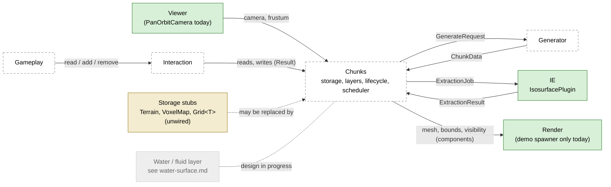

# Architecture

*Overview. Only the isosurface extractor exists; everything else here is a
proposal or an open decision. Written 2026-10-14 against commit `bee05ac`.*

## Summary

The project is a Bevy 0.16 voxel-terrain prototype. Today it has one working
system, the **isosurface extractor (IE)** in `src/voxel_terrain/isosurface/`,
plus a demo scene that meshes one hard-coded volume, and a few unwired storage
stubs. The planned world splits into five systems: **IE**, **Chunks**,
**Generator**, **Interaction** and **Render**. A sixth input, the **Viewer**,
drives streaming. Water is a separate design in progress
([water-surface.md](water-surface.md)) and is out of scope here. This document
is the entry point. It indexes the other docs, maps the systems and how they
talk, proposes a frame order, maps every file in the repo, and lists the
cross-cutting decisions (`X-n`) that more than one system depends on. The
per-system decisions live in each system's own doc.

Status rule used everywhere in `docs/`: a **fact** is something in the code
today, cited as `path:line`. Everything else is **proposed** or **open**.

---

## 1. Document index

| doc | covers | status | decisions |
|---|---|---|---|
| [architecture.md](architecture.md) | this file: system map, communication, schedule, file map, cross-cutting decisions, glossary | overview | [X-n](#6-cross-cutting-decisions) |
| [isosurface-extractor.md](isosurface-extractor.md) | the IE as built, its API and invariants, and open changes (apron margin, occupancy) | describes code | [IE-n](isosurface-extractor.md#decisions) |
| [chunks.md](chunks.md) | coordinates, storage, layers, lifecycle, scheduler, gather/apron, LOD data side | design | [CH-n](chunks.md#decisions) |
| [generator.md](generator.md) | procedural world data from seed + chunk position + LOD | design | [GEN-n](generator.md#decisions) |
| [interaction.md](interaction.md) | gameplay reads and edits of voxel values, through Chunks | design | [INT-n](interaction.md#decisions) |
| [rendering.md](rendering.md) | `Surface` to Bevy mesh/entity, materials, LOD meshing (Transvoxel), culling | design | [RND-n](rendering.md#decisions) |
| [art-direction.md](art-direction.md) | target look: Ocarina of Time DS, low-poly, colorful, old feeling; how it leans each open decision | goal | none |
| [transvoxel-face-ambiguity.md](transvoxel-face-ambiguity.md) | proof that our triangle table resolves ambiguous faces the way Lengyel's regular table does | analysis | none |
| [water-surface.md](water-surface.md) | water top-surface meshing | design in progress, out of scope here | its own §11 |

Also at the root: `README.md` (algorithms, benchmarks, tests) and `CLAUDE.md`
(conventions and traps).

---

## 2. System map

Solid boxes exist in code. Dashed boxes are proposed. Edge labels are message
names from §3; only the two IE edges exist.

What exists today:

- **IE**: `IsosurfacePlugin` (`src/voxel_terrain/isosurface/mod.rs:432`)
  registers the queue, the results and the scratch pool, and runs
  `drain_extraction_queue` in `Update` inside `ExtractSet` (`mod.rs:441`).
- **Viewer**: a `PanOrbitCamera` spawned at startup (`src/prototype.rs:13`).
  Nothing reads it.
- **Render (demo only)**: `spawn_extracted_surfaces`
  (`src/voxel_terrain/isosurface/debug.rs:47`) drains results and spawns one
  `Mesh3d` + `StandardMaterial` entity per surface, ordered `.after(ExtractSet)`
  (`debug.rs:28`). There is no chunk-aware rendering.
- **Stubs**: `Terrain` (`src/voxel_terrain/terrain.rs:10`), `VoxelMap`
  (`src/voxel_terrain/voxel.rs:3`) and `Grid<T>`
  (`src/voxel_terrain/voxels/grid/grid.rs:2`). `VoxelTerrainPlugin::build` is
  commented out (`src/voxel_terrain/mod.rs:18`), so none of them is in the app.
- **Chunks, Generator, Interaction**: nothing.

Water: the water design is in progress; see [water-surface.md](water-surface.md).

---

## 3. Communication

### 3.1 Messages

Names are proposals unless the status says "exists".

| from → to | message | carries | status |
|---|---|---|---|
| Viewer → Chunks | (none; read each frame) | camera transform and frustum | proposed |
| Chunks → Generator | `GenerateRequest` | chunk pos, LOD, version | proposed |
| Generator → Chunks | `ChunkData` | density + type | proposed |
| Chunks → IE | `ExtractionJob` | `buffer`, `isolevel`, `method`, `interpolate` | **exists** (`mod.rs:133`) |
| Chunks → IE | fields on `ExtractionJob` | chunk pos, version, LOD | proposed |
| IE → Chunks | `ExtractionResult` | `id: JobId`, `method`, `interpolate`, `surface` | **exists** (`mod.rs:177`) |
| IE → Chunks | fields on `ExtractionResult` | per-chunk flags (e.g. uniform, empty) | proposed (see IE doc) |
| Gameplay → Interaction | read / add / remove | point or region, brush, value | proposed |
| Interaction ↔ Chunks | reads; writes | writes return `Result<_, EditError>` | proposed |
| Chunks → Render | ECS components | mesh handle, bounds, visibility | proposed |

Facts about the existing pair:

- `IsosurfaceQueue::push` returns a `JobId` taken from a counter
  (`mod.rs:154-159`). The result echoes it back (`mod.rs:178`). This is the only
  way to match a result to a job today. The job has no chunk position, so a
  caller has to keep its own `JobId → chunk` map.
- `drain_extraction_queue` takes the whole queue and extracts every job
  synchronously, on whichever thread runs the system, with the one shared
  `ExtractionScratch` (`mod.rs:407-425`). There is no per-frame budget and no
  async task.
- `IsosurfaceResults::drain` empties the store (`mod.rs:192`). Whoever drains
  first gets everything; there is one consumer by design.
- `Surface` is plain `positions`, `normals`, `indices` (`mod.rs:217-221`).
  `into_mesh` keeps a CPU copy (`RenderAssetUsages::MAIN_WORLD | RENDER_WORLD`,
  `mod.rs:244`).

### 3.2 ECS mechanisms

The options for carrying the proposed messages. Which one each message uses is
decision [X-8](#x-8-message-mechanism).

| mechanism | how | good for | costs |
|---|---|---|---|
| Resource queue | a `Resource` holding a `Vec`, pushed by one system and drained by another; ordering by a `SystemSet`. This is what the IE does (`mod.rs:147`, `mod.rs:186`, `mod.rs:403`). | batch work, one consumer, explicit ownership | single consumer; ordering must be set by hand |
| Components | per-chunk state on the chunk entity (e.g. `ChunkState`, `Mesh3d`, `Aabb`, a `Task<T>`). Query with `Changed<T>` / `Added<T>`. | per-chunk state that lives as long as the chunk | the chunk entity must exist; structural changes go through `Commands` |
| Events (0.16) | `app.add_event::<T>()`, `EventWriter<T>` / `EventReader<T>`. Double-buffered; an event lives for about two frames, then is dropped. | fan-out notifications (e.g. "chunk edited") | readers that skip frames lose events; no back-pressure |
| Messages (0.17) | the same thing renamed: `Message`, `MessageWriter`, `MessageReader`, `add_message`. In 0.17 "Event" means an observer event. | as above | a rename on upgrade; avoid the word "event" in our own names |
| Observers | `commands.trigger(..)`, `Trigger<E>` observer systems (0.16; `On<E>` in 0.17). Run immediately. | rare, immediate reactions (e.g. despawn cleanup) | no batching; harder to reason about order |
| Async tasks | `AsyncComputeTaskPool::get().spawn(..)` returns a `Task<T>`; poll with `is_finished()` then `block_on(future::poll_once(&mut task))`. | generation and extraction off the main thread | the pool defaults to 25% of cores (min 1, max 4), shared by all async work; dropping a `Task` cancels it only before it starts |

Storing the `Task<T>` as a component on the chunk entity cancels it on despawn,
and the entity generation stops a reloaded chunk from accepting a stale result.
That is a proposal for [chunks.md](chunks.md#decisions).

---

## 4. Frame and schedule order

### 4.1 Today

| schedule | system | source |
|---|---|---|
| `Startup` | `prototype::init` (camera, ambient light) | `src/prototype.rs:8` |
| `Startup` | `queue_demo_surfaces`, `draw_sample_gizmos` | `isosurface/debug.rs:25` |
| `Update` | `drain_extraction_queue` in `ExtractSet` | `isosurface/mod.rs:441` |
| `Update` | `spawn_extracted_surfaces`, `.after(ExtractSet)` | `isosurface/debug.rs:28` |

The demo queues two jobs at startup, so the extraction runs once, in the first
`Update`.

### 4.2 Proposed (open decision X-9)

One candidate order, all in `Update`, before `ExtractSet` where it feeds the IE:

1. **Interaction**: gameplay reads and edit requests.
2. **Apply edits**: write values through Chunks, return `Result`, mark chunks
   dirty.
3. **Streaming**: compare the viewer position with the loaded window; queue
   loads and unloads (with hysteresis between the two radii).
4. **Poll generation**: collect finished `ChunkData`.
5. **Poll meshing**: collect finished surfaces; swap meshes in.
6. **Visibility**: frustum and occlusion culling.
7. **Scheduler**: score and pick jobs within the in-flight and upload caps.
8. **Gather + spawn**: build padded buffers and start tasks (or push onto
   `IsosurfaceQueue` if extraction stays synchronous).

Notes: `FixedUpdate` runs before `Update` in Bevy's main schedule, so anything
placed there (physics, a future fluid step) sees the previous frame's edits.
Whether 4–5 come before 6–8 decides whether a result can be shown in the frame
it finishes. See [X-9](#x-9-frame-order).

---

## 5. Repo file map

Lines are current line counts. "System" is the proposed system a file would
belong to; "–" means none.

### 5.1 Root and build

| path | lines | what it is | system |
|---|---|---|---|
| `Cargo.toml` | 20 | crate `bevy-verse`; deps `bevy 0.16` (features `bevy_dev_tools`, `bevy_remote`), `bevy_panorbit_camera 0.26`, `mimalloc`, `avian3d` from git `main` (unused, and resolved against Bevy 0.17.2, see [interaction.md](interaction.md)); `dev` feature = dynamic linking; dev profile at opt-level 1, deps at 3 | – |
| `Cargo.lock` | – | lockfile | – |
| `.gitignore` | 2 | ignores `/target` and `CLAUDE.md` (but `CLAUDE.md` is tracked) | – |
| `README.md` | 622 | algorithms, performance, tests, status, gotchas | – |
| `CLAUDE.md` | 39 | repo conventions and traps for agents | – |

### 5.2 `src/`

| path | lines | what it is | system |
|---|---|---|---|
| `src/lib.rs` | 1 | `pub mod voxel_terrain;` | – |
| `src/main.rs` | 50 | app setup: mimalloc global allocator (`:20`), `DefaultPlugins`, `PrototypePlugin`, `VoxelTerrainPlugin`, `IsosurfacePlugin`, `IsosurfaceDebugPlugin`, FPS overlay, `PanOrbitCameraPlugin` (`:25-49`) | app |
| `src/prototype.rs` | 21 | `PrototypePlugin`: spawns a `PanOrbitCamera` and sets `AmbientLight` | Viewer |
| `src/voxel_terrain/mod.rs` | 22 | declares submodules; re-exports `utils::util` as `util`; `VoxelTerrainPlugin` whose `build` is commented out (`:17-21`) | Chunks (future plugin root) |
| `src/voxel_terrain/terrain.rs` | 83 | `Terrain` resource: `HashMap<(i32,i32,i32), Grid<u8>>` + size (`:10-13`); `get` by world `IVec3`; `pos_div_size` world → (chunk, local) with one test. Unwired. See the note below. | Chunks (stub) |
| `src/voxel_terrain/voxel.rs` | 29 | `VoxelMap`: id `IVec3`, flat `Vec<i8>`, optional `Handle<Mesh>`, get/set. Not used anywhere. | Chunks (stub) |
| `src/voxel_terrain/utils/util.rs` | 31 | `XYZ` iterator over a cube, x fastest (`:1-27`); `position_from_index` corner bit decode (`:29`), unused | shared |
| `src/voxel_terrain/debug/mod.rs` | 19 | `VoxelTerrainDebugPlugin` running `voxels::debug::init` at startup; an unused `Debug` struct. Not added to the app. | Chunks (debug) |
| `src/voxel_terrain/debug/picking.rs` | 0 | empty | Interaction |
| `src/voxel_terrain/voxels/mod.rs` | 15 | declares `debug`, `grid`, `octree`; `GridPlugin` whose `build` is `todo!()` (`:13`) | Chunks (stub) |
| `src/voxel_terrain/voxels/debug/mod.rs` | 49 | `init`: draws one gizmo sphere per `Terrain` sample. Needs `Res<Terrain>`, which nothing inserts. | Chunks (debug) |
| `src/voxel_terrain/voxels/grid/mod.rs` | 1 | `pub mod grid;` | Chunks (stub) |
| `src/voxel_terrain/voxels/grid/grid.rs` | 154 | generic cubic `Grid<T>`: `get`, `get_mut`, `get_cell` (8 corners, same bit order as the IE), `get_edge_x` (one X row); 3 tests | Chunks (stub) |
| `src/voxel_terrain/voxels/octree.rs` | 1 | empty (one blank line) | Render or Chunks (LOD), undecided |

### 5.3 `src/voxel_terrain/isosurface/` (the IE)

All of these belong to the IE. Details in
[isosurface-extractor.md](isosurface-extractor.md).

| path | lines | what it is |
|---|---|---|
| `mod.rs` | 443 | `MAX_SIZE = 64` (`:88`), `Method` (`:97`), `ExtractionJob` (`:133`), `JobId`, `IsosurfaceQueue` (`:147`), `ExtractionResult` (`:177`), `IsosurfaceResults` (`:186`), `Surface` + `into_mesh` (`:217-250`), `extract_with` / `extract` (`:254`, `:270`), `case_index`, `edge_t`, `place_at`, `gradient_normal`, `sample_gradient` (`:360`), `ExtractSet` (`:404`), `drain_extraction_queue` (`:407`), `IsosurfacePlugin` (`:432`) |
| `buffer.rs` | 131 | `VoxelBuffer`: cubic `Vec<i8>`, X-major, with `row`, `cell_corners`, get/set |
| `scan.rs` | 508 | `RowScan`: passes 1–3 (`pass_1` `:241`, `pass_2` `:300`, `pass_3` `:361`); asserts `size <= MAX_SIZE` (`:160`) |
| `flying_edges.rs` | 450 | welded emission with gradient normals; `owned_slots` (`:178`) |
| `marching_cubes.rs` | 208 | unwelded emission with face normals |
| `output.rs` | 129 | write-once, uninitialized output buffers; `Output::finish` is the one `unsafe` step; debug sentinel check |
| `scratch.rs` | 134 | `ExtractionScratch` resource: `corner_masks`, `rows`, `offsets`, reused across runs |
| `tables.rs` | 423 | `VERTEX_POSITIONS`, `EDGE_VERTEX_INDICES`, `TRIANGLE_COUNT`, `ORDER`, `EDGE_INTERSECTION`, `TRIANGLE_TABLE`, `EDGE_AXIS_ORIGIN`. The first ASCII diagram (`:23-34`) is stale. |
| `test_maps.rs` | 140 | hand-made `i8` fields (terrain, cube, single voxel, scattered, slab, sphere, pseudo-random); public, used by the demo and the bench |
| `debug.rs` | 145 | `IsosurfaceDebugPlugin`: queues the `solid_cube(4)` field through both methods, spawns the meshes side by side, draws sample gizmos |
| `tests.rs` | 703 | cross-validation against a longhand marching cubes, plus winding, normal, pool and table tests |

### 5.4 Other directories

| path | what it is | system |
|---|---|---|
| `examples/isosurface_bench.rs` (144 lines) | release-only timing harness: every (method, cold/pooled) pair over the test maps | IE |
| `assets/shaders/storage_buffer.wgsl` (37 lines) | vertex/fragment shader colouring instances from a 5-entry storage buffer. Not loaded by any code. | Render (unused) |
| `assets/test-level.glb`, `test-level.blend`, `test-level.blend1` | a glTF test level and its Blender 4.2 sources. Not loaded. | – |
| `assets/grid.png` | 256×256 PNG texture. Not loaded. | – |
| `assets/8159285.webp` | 639×450 WebP image. Not loaded. | – |
| `docs/*.md` | see §1 | – |

Notes on the stubs:

- `pos_div_size` (`terrain.rs:41-59`) adds −1 to the quotient for every
  negative coordinate. That is wrong at exact negative multiples of the size:
  for size 8, `x = -8` gives chunk −2 and local 8, which is out of range. The
  test only checks `-9` (`terrain.rs:79`). `div_euclid` / `rem_euclid` would
  fix it. Not urgent while the file is unwired.
- `Terrain` stores `u8`, `VoxelMap` and the IE store `i8`. See
  [X-1](#x-1-value-encoding).
- Adding `GridPlugin` panics (`todo!()`); adding `VoxelTerrainDebugPlugin`
  without inserting `Terrain` panics on the missing resource.

---

## 6. Cross-cutting decisions

These affect more than one system. Each is open. "Recommended" marks a
suggestion, never a decision.

### X-1 Value encoding

What is a voxel sample? Today it is `i8`, solid when `> isolevel`
(`mod.rs:276-284`, `buffer.rs:14`).

| option | trade-offs |
|---|---|
| a. Keep `i8` signed density | no IE change. Noise maps onto it directly. Values are not volumes, so edits and fluids are less natural. |
| b. `u8` occupancy, 0 = empty … max = full | edits become `max`/`min` (idempotent); matches the water design's occupancy. IE change is mostly a type change; `tables.rs` is unaffected (its `i8` is table data with a −1 sentinel). Tests port by +128, which preserves order, so positions stay bit-identical. With a ~1-voxel ramp, central differences saturate and normals snap toward the axes. |
| c. `u16` or `f32` | more precision, 2–4× the memory and scan bandwidth. |

Affects: IE (types, normals), Chunks (storage size), Generator (ramp), Interaction (brush maths), Render (shading).
Recommended: b, because edits and the water design both want occupancy; the normal saturation is decision IE/RND material, not a blocker.

### X-2 Configurable max and isolevel

Today the isolevel is per job (`mod.rs:135`); there is no max.

| option | trade-offs |
|---|---|
| a. Compile-time constants | fastest, simplest; one look per build. |
| b. Per-world config resource | e.g. max 15, iso 7 for a choppy look; every system reads the same config. |
| c. Per-job, as today | most flexible; nothing stops two chunks disagreeing at a seam. |

Related: interpolating toward `iso + 0.5` instead of `iso` keeps vertices off
grid points. With integer samples a sample equal to the isolevel gives `t = 0`
and degenerate triangles. The water design has its own rules for how its
resolution relates to the terrain's ([water-surface.md](water-surface.md)).

Affects: IE, Generator, Interaction, Render, water.

### X-3 Chunk size

The IE accepts at most 64 samples per axis (`mod.rs:88`, enforced at
`scan.rs:160`). With a 1-sample apron (X-4) the IE input for N cells is N + 3
samples.

| cells per chunk | IE input | notes |
|---|---|---|
| 16 | 19³ | many chunks, many entities and draws; cheap remesh |
| 32 | 35³ | ~2,000 dense chunks at radius 16 ≈ 128 MiB at 2 B/voxel; meshes ≈ 55 KB each |
| 61 | 64³ | the maximum that fits; fewer, larger remeshes per edit |
| 64 | 67³ | does not fit the `u64` row masks |

Affects: Chunks (coordinates: `>> 5` / `& 31` only for powers of two), IE, Render (draw count), Interaction (edit latency).
Recommended: 32, because it is a power of two and fits with the apron.

### X-4 Apron storage

The seam bug is real: `sample_gradient` uses one-sided differences on buffer
faces (`mod.rs:369-376`), so two chunks compute different normals for the same
border vertex. Positions match to within one ULP (see
[isosurface-extractor.md](isosurface-extractor.md#open-questions)). A 1-sample apron on each side fixes it if the
IE meshes only the inner cells (an IE change, see
[isosurface-extractor.md](isosurface-extractor.md#decisions)).

| option | trade-offs |
|---|---|
| a. Store a padded block per chunk | gather is a memcpy; an edit near a border writes up to 8 copies |
| b. Store N³, gather from up to 26 neighbours | one copy per voxel; needs neighbours loaded, so data loads one ring beyond the mesh radius or the outermost chunks never mesh |
| c. Generator writes a padded block | cheap for unedited chunks only; edits still need a or b |

An edit dirties up to 7 neighbours at a corner. Affects: Chunks, Generator, Interaction, IE.

### X-5 World bounds

| option | trade-offs |
|---|---|
| a. Unbounded on all axes | no special cases; memory grows with the vertical view range |
| b. Height limit (e.g. ±256), air above, bedrock below | far fewer loaded chunks; out-of-bounds reads have a defined answer; needs an `OutOfBounds` edit error |
| c. Fixed finite world | simplest storage (a flat array of chunks); limits the game |

Affects: Chunks (memory, streaming), Generator, Interaction (errors), Render (culling).

### X-6 Threading model

Today extraction is synchronous inside an `Update` system with one scratch pool
(`mod.rs:407-425`).

| option | trade-offs |
|---|---|
| a. Main thread, as today, with a per-frame budget | simple; frame time grows with the work |
| b. One chunk per `AsyncComputeTaskPool` task, scratch per worker (thread-local or returned to a pool) | scales with cores; needs versioned results; the pool is 25% of cores (min 1, max 4) unless `TaskPoolOptions` is tuned |
| c. Split one extraction across threads (z blocks) | lower latency for one chunk; blocked by pass-2 cross-row writes (README, Project status) |
| d. Dedicated thread pool outside Bevy's | full control; more code |

Generation and meshing share whichever pool is chosen. Affects: IE (scratch ownership), Chunks (lifecycle, versioning), Generator.
Recommended: b, because one chunk per worker needs no IE change beyond scratch ownership.

### X-7 Edits persistence

| option | trade-offs |
|---|---|
| a. None (edits lost on unload) | trivial; unloading a chunk undoes edits |
| b. Snapshot the edited chunk's grid | simple and exact; size per edited chunk (compressible) |
| c. Operation log ("subtract sphere at P, r") | tiny; replays at any LOD; grows and needs compaction |
| d. Hybrid: log, compacted into snapshots | best of both; most code |

Affects: Chunks, Interaction, Generator (replay on top of generated data), LOD (Render).

### X-8 Message mechanism

Which §3.2 mechanism carries each proposed message: resource queues (the IE's
pattern), components, events/messages, observers, or tasks. Mixing is fine; the
question is a rule. One rule: per-chunk state in components, batch work in
resource queues, notifications in events. Affects every system and the 0.17
upgrade (Events → Messages).

### X-9 Frame order

The §4.2 order, or another. Open points: whether edits run in `Update` or
`FixedUpdate`; whether polling comes before or after scheduling; caps on jobs in
flight and mesh uploads per frame. Affects: Interaction latency, Chunks,
Render.

### Decisions tables

| ID | question | options | recommended | affects |
|---|---|---|---|---|
| X-1 | sample encoding | `i8` density / `u8` occupancy / wider | `u8` occupancy | IE, CH, GEN, INT, RND |
| X-2 | where max and isolevel live | const / world config / per job | – | IE, GEN, INT, RND, water |
| X-3 | cells per chunk | 16 / 32 / 61 | 32 | CH, IE, RND, INT |
| X-4 | apron storage | padded / gather / generator-padded | – | CH, GEN, INT, IE |
| X-5 | world bounds | unbounded / height limit / finite | – | CH, GEN, INT, RND |
| X-6 | threading | main thread / task per chunk / split chunk / own pool | task per chunk | IE, CH, GEN |
| X-7 | edits persistence | none / snapshot / op log / hybrid | – | CH, INT, GEN, RND |
| X-8 | message mechanism | queues / components / events / observers / tasks | – | all |
| X-9 | frame order | §4.2 / other | – | INT, CH, RND |

Per-system decisions:

| prefix | doc |
|---|---|
| IE-n | [isosurface-extractor.md#decisions](isosurface-extractor.md#decisions) |
| CH-n | [chunks.md#decisions](chunks.md#decisions) |
| GEN-n | [generator.md#decisions](generator.md#decisions) |
| INT-n | [interaction.md#decisions](interaction.md#decisions) |
| RND-n | [rendering.md#decisions](rendering.md#decisions) |
| water | [water-surface.md](water-surface.md#11-open-questions) (design in progress) |

---

## 7. Glossary

| term | meaning |
|---|---|
| **sample** | one value of the field at a grid point. Today an `i8` in a `VoxelBuffer` (`buffer.rs:14`). |
| **voxel** | used loosely for a sample. Where it matters, say sample or cell. |
| **cell** | the cube between 8 neighbouring samples. A buffer of `size` samples has `size − 1` cells per axis (`buffer.rs:49`). |
| **corner index** | 0–7, x = bit 0, y = bit 1, z = bit 2 (`tables.rs:41`). |
| **isolevel** | the threshold. Solid when a sample is `> isolevel`, empty when `<=` (`mod.rs:276-284`). Per job today. |
| **density** | a signed field value, like today's `i8` samples. Not a true distance when it comes from noise. |
| **occupancy** | proposed `u8` value: 0 = empty, max = full (X-1). |
| **ramp** | the band of intermediate occupancy values across a surface. Its width sets how smooth positions and normals are. |
| **case index** | 8-bit cell classification; bit `i` set when corner `i` is empty (`mod.rs:276`). Cases 0 and 255 emit nothing. |
| **ambiguous face** | a cell face whose four corners alternate solid/empty diagonally. Our table keeps the empty corners apart, so solid joins diagonally ([transvoxel-face-ambiguity.md](transvoxel-face-ambiguity.md)). |
| **row mask** | a `u64` with bit `x` set when sample `x` of an X row is empty (`scratch.rs:37-39`). The reason for `MAX_SIZE = 64`. |
| **trim** | per-row bounds outside which a row has no geometry (`scan.rs`). |
| **flying edges / marching cubes** | the two IE methods: welded with gradient normals / unwelded with face normals (`mod.rs:97-122`). |
| **ownership** | in flying edges, each cell writes only the edges at its minimum corner, plus boundary extras (`flying_edges.rs:178`). |
| **apron** | extra samples around a chunk's own data, copied from neighbours, so border normals match (X-4). |
| **gather** | building one IE input buffer from a chunk and its apron. |
| **seam** | the shared face between two chunks' meshes. Positions match today to within one ULP; normals don't. |
| **chunk** | proposed unit of storage, streaming and meshing (X-3). |
| **layer** | a per-sample channel owned by Chunks (e.g. terrain density, type; water is separate). |
| **uniform chunk** | every sample identical (storage sense), or every sample on one side of the isolevel (meshing sense). Not the same thing. |
| **LOD** | level of detail. LOD L samples every 2^L LOD0 voxels. |
| **clipmap** | LOD layout of nested rings around the viewer, each twice the scale of the one inside. |
| **octree** | LOD layout as a tree of chunks that split near the viewer. |
| **Transvoxel** | Lengyel's method for crack-free seams between LODs: transition cells on the faces of coarse chunks, with their own tables (512 cases, 56 classes). |
| **skirt** | a cheaper LOD seam fix: extra geometry hanging down from chunk borders to hide cracks. |
| **viewer** | the camera or player position that drives streaming. |
| **hysteresis** | unload radius larger than load radius, so a chunk at the edge doesn't flicker in and out. |
| **mesh epoch / version** | counters that tell a finished result whether its inputs changed while it ran. |

---

## Open questions

- Does any non-water system need a fluid layer slot in storage from the start,
  or can Chunks add it later? (Water design is in progress; see
  [water-surface.md](water-surface.md).)
- Should the stubs (`terrain.rs`, `voxel.rs`, `Grid<T>`, `octree.rs`,
  `picking.rs`) be deleted, kept as reference, or grown into Chunks?
- Is `avian3d` staying, and on which Bevy? Git `main` resolves to avian 0.4.0
  built against Bevy 0.17.2 (`Cargo.lock`), so the app compiles two Bevy
  versions and avian can't be used with the app's 0.16. Physics needs an avian
  release for 0.16 or a move to Bevy 0.17.
- Are the unused assets (`storage_buffer.wgsl`, the test level, `grid.png`,
  the WebP image) still wanted?
- Is there a target frame budget or view distance? The memory and scheduling
  numbers in X-3 and X-6 need one to become decisions.
- Single-player only, or will edits ever be networked? It changes X-7.
