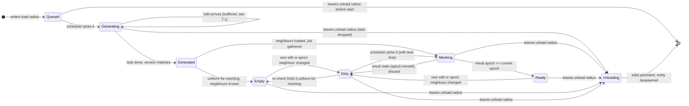

# Chunks

*Design notes, 2026-10-14. Only the section "What exists today" describes code.
Everything else is an open decision: options and trade-offs, not a plan.*

## Summary

Chunks is the system that owns the world's voxel data and its lifecycle. It
stores the samples, keeps the layers, and is the only system that writes to
them. It decides which chunks are loaded from the Viewer's position, asks the
Generator for new data, gathers padded buffers for the IE, and hands finished
surfaces to Render. Today none of this exists. There is an unwired storage
layer (`terrain.rs`, `voxel.rs`, `voxels/grid`) that is partly reusable, and
the IE, which takes one buffer at a time and knows nothing about chunks. This
doc lists what is there, then the open decisions: coordinates, storage, the
apron that fixes the normal seam, the lifecycle, versioning, scheduling,
streaming, the data side of LOD, and edit persistence.

See also: [architecture.md](architecture.md) (system map),
[isosurface-extractor.md](isosurface-extractor.md),
[generator.md](generator.md), [interaction.md](interaction.md),
[rendering.md](rendering.md).

---

## 1. Responsibilities and boundaries

| Chunks does | Chunks does not |
|---|---|
| store samples per chunk, per layer | produce procedural data (Generator) |
| map world positions to chunks and back | extract surfaces (IE) |
| decide what is loaded, from the Viewer | build Bevy meshes or materials (Render) |
| schedule generation and meshing jobs | decide what gameplay may edit (Interaction) |
| gather a padded buffer per meshing job | simulate fluids (water design in progress) |
| apply writes from Interaction, track dirty chunks | raycasts (see INT decisions in interaction.md) |

Chunks is the single writer of every layer. Interaction asks Chunks to write
and gets a `Result` back. The Generator returns data; Chunks stores it.

---

## 2. What exists today

`VoxelTerrainPlugin` is added to the app (`src/main.rs:27`), but its `build`
is commented out (`src/voxel_terrain/mod.rs:17-21`). Nothing below runs in
the app. The only live voxel path is the IE demo, which meshes one hardcoded
volume.

| piece | where | what it is | reusable? |
|---|---|---|---|
| `Terrain` resource | `terrain.rs:9-13` | `HashMap<(i32,i32,i32), Grid<u8>>` plus one `size` | The map-of-chunks shape, yes. The type, no: `u8` samples, no LOD, no entity, no layers. |
| `Terrain::new` | `terrain.rs:19-26` | one all-zero chunk at the origin | No. |
| `Terrain::get` | `terrain.rs:28-38` | world position to sample | Idea only; inherits the bug below. |
| `pos_div_size` | `terrain.rs:41-59` | world position to (chunk key, local position) | No. **Wrong on exact negative multiples**, see below. |
| `global_to_local` test | `terrain.rs:67-82` | checks 0, 12 and -9 at size 8 | Keep the idea; add the cases that fail today. |
| `SIZE_FOR_NOW = 5.0` | `terrain.rs:7` | world spacing used by the debug gizmos | No. |
| `Grid<T>` | `voxels/grid/grid.rs:1-72` | generic cube, X-major (`grid.rs:13-15`), `get`, `get_mut`, `get_edge_x` (one X row), `get_cell` (8 corners) | Partly. Layout and corner order match the IE. `new` does not check `cells.len() == size³` (`grid.rs:9-11`), unlike `VoxelBuffer::from_samples` (`buffer.rs:31-40`). |
| `Grid` tests | `grid.rs:74-153` | `new_grid`, `x_edge`, `cell` | Yes, if `Grid` stays. |
| `VoxelMap` | `voxel.rs:3-29` | `Vec<i8>` plus `id: IVec3` plus `Option<Handle<Mesh>>` | No. It mixes render state into storage, and `get_chunk` clones the whole vector (`voxel.rs:26-28`). Unused. |
| `GridPlugin` | `voxels/mod.rs:9-15` | `build` is `todo!()` | No. Adding it would panic at startup. |
| `voxels/debug::init` | `voxels/debug/mod.rs:8-49` | a gizmo sphere per sample of every `Terrain` chunk | Possibly, as a debug view. Its solid test is `value > 0` (`:25`), which hard-codes isolevel 0. It also draws a stray cuboid at the origin (`:16`). |
| `VoxelTerrainDebugPlugin` | `debug/mod.rs:8-19` | runs `voxels/debug::init` at startup | Not added anywhere. `init` takes `Res<Terrain>` (`voxels/debug/mod.rs:11`), and the only insert is commented out (`mod.rs:20`), so adding the plugin alone would fail on the missing resource. The `Debug` struct (`:10-12`) is unused. |
| `XYZ` iterator | `utils/util.rs:1-27` | x-fastest `(x, y, z)` over a cube | Yes. Used by `isosurface/debug.rs:101` and `scan.rs:460`. |
| `position_from_index` | `utils/util.rs:29-31` | corner index to `(x, y, z)` bits | Yes. Matches the corner convention. Unused. |
| `octree.rs`, `picking.rs` | | empty files | No content. |

### The type mismatches

Three containers overlap:

- `VoxelBuffer` (`isosurface/buffer.rs:13-16`): `Vec<i8>`, the IE's input.
- `Grid<u8>` inside `Terrain` (`terrain.rs:11`).
- `VoxelMap` (`voxel.rs:5`): `Vec<i8>`.

All three use the same X-major index `x + y·size + z·size²`
(`buffer.rs:62-64`, `grid.rs:13-15`, `voxel.rs:17`). So the layouts agree;
only the element types differ. The IE's isolevel is `i8` too
(`isosurface/mod.rs:135`). Whatever value type CH-3 picks, only one of these
containers should survive.

### The `pos_div_size` bug

```rust
fn minus_div(n: i32, s: i32) -> i32 {
    let c = if n < 0 { -1 } else { 0 };
    (n / s) + c                         // terrain.rs:42-45
}
```

Rust's `/` truncates toward zero, so this is floor division only when `n` is
negative and not a multiple of `s`. For `n = -8, s = 8` it returns `-2`
(should be `-1`), and the local coordinate becomes `-8 - (-16) = 8`, which is
out of range. `Grid::get` then returns `None` (`grid.rs:38-46`), so
`Terrain::get` silently reports "no data" for every voxel on the face
`x = -8k`. The test uses `-9` (`terrain.rs:79`), which happens to work.

---

## 3. Coordinates

Three spaces:

| space | type | meaning |
|---|---|---|
| world voxel | `IVec3` | one integer per LOD0 sample |
| chunk key | `IVec3` + LOD | which chunk |
| local | `UVec3` (or `usize`s) | sample inside a chunk, `0..N` |

With `N` samples owned per chunk per axis at LOD0:

```
chunk = world.div_euclid(N)        local = world.rem_euclid(N)
world = chunk * N + local
```

If `N` is a power of two (`N = 32`), this is `world >> 5` and `world & 31`,
which are also correct on negatives. Never use `/` or `%` on signed values.

**LOD in the key.** A chunk at LOD `L` covers `N · 2^L` world voxels per axis
with samples spaced `2^L` apart. Its key coordinates are in units of its own
size:

```
chunk_L = world.div_euclid(N << L)
local_L = world.rem_euclid(N << L) >> L      // only exact for world on the LOD-L grid
```

So the key is `(IVec3, u8)` or a packed integer. Keying LOD0 and LOD1 chunks by
the same `IVec3` would collide; see CH-1.

**World index.** Options for finding a chunk by key:

| option | lookup | notes |
|---|---|---|
| `HashMap<ChunkKey, Entity>` | hash | any shape, any extent; one map entry per loaded chunk |
| ring buffer per LOD over the loaded window | array index `key & mask` | O(1), no hashing; window size fixed per LOD; must check the stored key to reject a stale slot |

The tests should cover negative multiples of `N` (the case `pos_div_size`
gets wrong), `-1`, `0`, `N - 1`, `N`, and round trips at every LOD.

---

## 4. Storage

### 4.1 Layout

| option | layout | trade-off |
|---|---|---|
| SoA | one array per channel (density, type) | The IE scans density rows only (`scan.rs` pass 1). A row is contiguous, as `VoxelBuffer::row` needs (`buffer.rs:76-79`). |
| AoS | `(density, type)` pairs | One cache line holds both; but the IE's row scan reads twice the bytes and needs a copy out. |

Recommended: SoA, because the hottest reader (the IE scan) wants density only.

### 4.2 Uniform channels

Each channel can be either uniform or dense:

```rust
enum Channel<T> { Uniform(T), Dense(Box<[T]>) }   // proposal
```

An all-air or all-solid chunk then costs about 16 B per channel, plus its
entity and map entry. That is far less than 2 B × 32³ = 64 KiB.

Keep two ideas apart:

- **Uniform storage:** every byte in the channel is identical. A storage fact.
- **Uniform for meshing:** every sample the mesher reads is on one side of the
  isolevel. It is weaker (a chunk of values 0..6 with iso 7 is uniform for
  meshing but not in storage). It also depends on neighbours: the mesher reads
  the `+` neighbour's samples (section 5), so it must be re-checked when a
  neighbour changes.

The meshing test is "every row mask all zeros, or every row mask all ones" over
the samples the mesh reads. "AND of masks equals OR of masks" is wrong: it
passes a chunk of stripes. Details are in [rendering.md](rendering.md)
(culling).

### 4.3 Compression

| option | where it helps | cost |
|---|---|---|
| uniform channels (4.2) | air and deep rock | an enum match per access |
| run-length per X row | layered terrain, mostly-air rows | random access needs a row decode; edits re-encode a row |
| `lz4_flex` for cached or inactive chunks | chunks outside the active radius, save files | decompress before use; adds a crate |

Mesh memory (positions quantised to chunk-local integers, packed normals) is a
Render decision; see [rendering.md](rendering.md).

### 4.4 Memory estimate

At 2 B per voxel (density + type) and 32³ chunks, one dense chunk is 64 KiB.

```
2,000 dense chunks × 64 KiB ≈ 125 MiB      (radius 16 at LOD0)
each extra clipmap ring     ≈ 96 MiB
one mesh                    ≈ 55 KB
```

The 2,000 figure assumes most chunks in the radius are uniform. A full sphere
of radius 16 chunks holds about 17,000 chunks, so the uniform optimisation and
a world height limit (GEN-6) decide the real number. With a padded block
(5.2 option a) at 35³, a dense chunk grows to about 84 KiB (+31%).

`Surface::into_mesh` keeps a CPU copy of every mesh
(`RenderAssetUsages::MAIN_WORLD | RENDER_WORLD`, `isosurface/mod.rs:244`). That
is a Render decision, but it counts against the same budget.

---

## 5. Gather and apron

### 5.1 The seam bug

`sample_gradient` (`isosurface/mod.rs:360-379`) uses central differences inside
the buffer and one-sided differences on its faces (`:369-376`). Two chunks that
share a face both have a vertex on that face, at the same position. But each
computes its normal with a one-sided difference that looks into its own chunk
only. The two normals differ, so lighting shows a line along every chunk
border. Positions match to within one float rounding step (about 11.5% of
crossings on X and Y faces differ by one ULP, see [isosurface-extractor.md](isosurface-extractor.md#open-questions));
the normals are what visibly break.

### 5.2 The fix: a 1-sample apron

If the buffer has one extra sample beyond each side of the cells being meshed,
every sample a vertex uses has both neighbours, and both chunks compute the
same central difference.

With `N` cells per chunk, the mesh needs samples `0..=N`; the gradients at
samples `0` and `N` need `-1` and `N+1`. The IE input is therefore `N + 3`
samples per axis, local index `-1..=N+1`:

| cells `N` | IE input | fits `MAX_SIZE = 64`? |
|---|---|---|
| 32 | 35 | yes |
| 61 | 64 | yes, the maximum |
| 64 | 67 | no (`scan.rs:159-164` panics) |

The IE must then mesh only the inner cells. Today it meshes every cell of the
buffer. That change touches the scan masks and ranges, both emitters, the
`owned_slots` boundary rule, a −margin position shift (buffer sample 1 becomes chunk-local 0), and
the ownership tests. One
option is an "interior margin" parameter (0 for today's callers, 1 for Chunks),
so the existing tests keep passing. That is an IE decision; see
[isosurface-extractor.md](isosurface-extractor.md).

A 3×3×3 gradient stencil (one of the occupancy normal options in generator.md,
section 5) needs an apron of 2: 37 samples per axis at 32 cells.

### 5.3 Where the apron lives

| option | gather | edits | needs |
|---|---|---|---|
| (a) padded block per chunk, `(N+3)³` stored | a `memcpy` (or no copy) | an edit near a border writes up to 8 copies of the same sample | Chunks keeps the copies in sync |
| (b) store `N³`, gather from neighbours | copy from the chunk and up to 26 neighbours | one write per sample | neighbours loaded; data loaded one ring beyond the mesh radius, or the outermost chunks never mesh |
| (c) Generator writes the padded block | as (a) | as (a) | only valid for unedited chunks; edited chunks still need (a) or (b) |

**Which neighbours an edit dirties (option b).** Per axis, local samples `0`
and `1` feed the `−` neighbour (its sample `N` and its apron `N+1`), and sample
`N−1` feeds the `+` neighbour's apron `-1`. Each axis adds at most one
neighbour direction, so an edit near a corner dirties the chunk plus up to 7
neighbours.

Recommended: (b), because edits write once and the extra data ring is also what
streaming hysteresis and the LOD downsample filter need.

---

## 6. Layers

A layer is one set of per-sample channels with its own version counter.

| layer | channels | status |
|---|---|---|
| terrain | density (or occupancy), material type | the only layer this doc covers |
| water / fluid | — | the water design is in progress; see [water-surface.md](water-surface.md) |

Chunks is the only writer of both. The terrain layer is written by the
Generator's output (via Chunks) and by Interaction (via Chunks).

---

## 7. Lifecycle (proposed)

States are per chunk entity. The Task handle can live as a component on the
entity, so despawning the entity drops the task.



### 7.1 Edge cases

| case | what can go wrong | options |
|---|---|---|
| unload while a task is in flight | the result arrives for a chunk that is gone | Dropping a Bevy `Task` cancels it only if it has not started. A started task runs to the end. With the Task as a component, the result is dropped with the entity. If results go through a channel instead, they must carry the `Entity`; Entity generations make a reloaded chunk a different entity, so no ABA. |
| edit while generating | the edit is lost when generated data lands, or lands on garbage | refuse (`NotLoaded`); buffer the edit and apply it after `Generated`; or log the op and replay it (fits the op log in section 12) |
| task never finishes | the chunk sits in `Generating` forever and blocks its neighbours from meshing | a deadline per task, then log and re-queue; generation is pure, so a hang is a bug, but a watchdog keeps the world usable |
| empty chunk dirtied by a neighbour | a uniform-air chunk gets geometry when the `+` neighbour's sample `N` turns solid | `Empty` is "uniform for meshing", which depends on neighbour samples, so neighbour changes must dirty `Empty` chunks too |
| LOD handover | holes while the new LOD's chunks mesh | keep the old mesh until all replacement chunks are `Ready`, then swap in one frame; see 11.3 |
| load/unload flicker | the Viewer stands on a radius boundary | separate load and unload radii (section 10) |
| missing neighbour at the outer ring | the chunk can never gather (5.3 option b) | load data one ring beyond the mesh radius; those outer chunks reach `Generated` but never mesh |

---

## 8. Versioning

One counter per chunk is not enough.

| counter | bumped when | used for |
|---|---|---|
| terrain version | any terrain sample of this chunk changes | persistence, "is this result for current data" |
| fluid version | the water layer changes (water design in progress) | keeps fluid ticks from remeshing terrain |
| mesh epoch | this chunk, or any neighbour whose samples feed this chunk's apron, changes | accept a mesh result only if the epoch it was gathered at is still current |

Options for the mesh epoch:

| option | cost | notes |
|---|---|---|
| a counter per chunk that Chunks bumps on the chunk and its up to 7 affected neighbours | one `u32` compare | Chunks must find the neighbours on every write; it already does for dirty flags |
| store the 27 terrain versions read at gather time and compare on completion | 27 compares, 108 B per job | no extra bookkeeping on writes |

Recommended: the first, since edits already compute the affected neighbours.

The IE today returns only a `JobId` (`isosurface/mod.rs:142-143`, `:177-182`).
Chunk, LOD and epoch can either be added to `ExtractionJob` /
`ExtractionResult`, or Chunks can keep `HashMap<JobId, (Entity, epoch)>` and
leave the IE untouched (IE decision).

---

## 9. Scheduler and budgets

**Facts (Bevy 0.16).** `AsyncComputeTaskPool` defaults to 25% of cores, min 1,
max 4 threads, and generation and meshing would share it; `TaskPoolOptions`
changes this. Poll a task with `block_on(future::poll_once(&mut task))` after
checking `is_finished()`. Today's IE runs synchronously inside `Update`
(`drain_extraction_queue`, `isosurface/mod.rs:407-425`) with one shared
`ExtractionScratch` resource (`:440`), so running it on tasks needs one scratch
per worker (thread-local or a returned pool). One chunk per worker beats
splitting one extraction across threads.

**Frame order (proposed), in `Update`.** FixedUpdate runs before Update.

```
interaction → apply edits → streaming → poll generation → poll meshing
  → visibility → scheduler → gather + spawn jobs   (all before ExtractSet)
```

**Priority.** Options:

| option | notes |
|---|---|
| FIFO | simple; far chunks can starve near ones |
| priority heap on (visible, in frustum, distance) | needs re-scoring; re-score when the Viewer crosses a chunk boundary, not every frame |
| heap plus a separate high-priority lane for edits | an edit's remesh never waits behind streaming |

Recommended: heap plus an edit lane, because edit latency is what the player
feels.

**Budgets.** Cap jobs in flight (generation and meshing separately or shared)
and cap main-thread mesh uploads per frame. No numbers are set; see Open
questions.

---

## 10. Streaming radius and hysteresis

The Viewer's camera transform and frustum are read each frame (proposed). The
loaded set is recomputed when the Viewer's chunk changes.

| radius | meaning |
|---|---|
| mesh radius `R` | chunks that should have a mesh |
| data radius `R + 1` | needed if the apron is gathered from neighbours (5.3 b) |
| unload radius `R + h` | a chunk is unloaded only beyond this |

`h` of 1 to 2 chunks stops flicker on a boundary. Distance can be Chebyshev
(a cube of chunks) or Euclidean (a sphere, about half the chunks of the cube at
the same radius). With a world height limit (GEN-6), the vertical extent is
clamped, so the loaded set is a cylinder or box.

---

## 11. LOD, the data side

Meshing across LOD boundaries (clipmap vs octree, skirts vs Transvoxel, the
2:1 neighbour rule) belongs to [rendering.md](rendering.md). This section is
only about the samples.

### 11.1 What is kept per LOD

| option | memory | notes |
|---|---|---|
| LOD0 only near the Viewer; coarse chunks generated directly at step `2^L` | one ring per LOD | unedited coarse chunks are cheap (generator.md, GEN-1); edited regions need 11.2 |
| full mip pyramid of every loaded LOD0 chunk | +1/7 (1/8 + 1/64 + …) | coarse data always matches the edits; costs memory and a downsample per edit |
| coarse chunks from the edit log replayed at their LOD | small | only works with the op-log persistence option (section 12) |

Transvoxel, if chosen, also needs fine samples on the coarse chunk's
transition faces.

### 11.2 Downsampling

Needed whenever coarse data must reflect LOD0 edits.

| filter | result |
|---|---|
| point sample (take fine `2i`) | coarse LODs turn binary; thin features pop in and out |
| 2×2×2 box average | shifts the field by half a fine voxel, so coarse surfaces move |
| 1-2-1 tent centred on fine `2i` | keeps alignment; needs fine samples `2i-1..=2i+1`, so one fine sample from the `−` neighbour |

```
coarse[i] = Σ w(a) w(b) w(c) · fine[2i + (a,b,c)] / 64,   a,b,c ∈ {-1,0,1},  w = (1,2,1)
```

Recommended: the tent, because it is the only option that neither shifts nor
binarises.

### 11.3 Handover

Keep the old LOD's chunks (data and mesh) until every replacement chunk is
`Ready`, then switch in one frame. A chunk is unloaded only after its
replacement covers it.

---

## 12. Edits persistence

Nothing persists today. Options:

| option | size | replay at other LODs | cost |
|---|---|---|---|
| snapshot: store the edited chunk's grid | 64 KiB per chunk, less with lz4 | no; downsample instead | simple and exact |
| operation log: "subtract sphere at P, r" | bytes per edit | yes, replay at any LOD | grows forever; needs compaction; replay must be deterministic |
| hybrid: log, compacted into snapshots | bounded | partly | two code paths |

Where saves live, and whether they are keyed by seed, is not specified.

---

## 13. Interfaces (all proposed)

| with | direction | proposal |
|---|---|---|
| Viewer | → Chunks | camera transform and frustum, read each frame |
| Generator | Chunks → | `GenerateRequest { pos, lod, version }`; see [generator.md](generator.md) |
| Generator | → Chunks | `ChunkData` (density + type); Chunks stores it |
| IE | Chunks → | `ExtractionJob` (gathered buffer, isolevel, method, + chunk / version / LOD, which do not exist today, `mod.rs:133-138`) |
| IE | → Chunks | `ExtractionResult` (`Surface`, + per-chunk flags if the IE gains them) |
| Interaction | ↔ Chunks | reads; writes return `Result<_, EditError>` with `NotLoaded`, `OutOfBounds` (water may add a variant); see [interaction.md](interaction.md) |
| Render | Chunks → | mesh, bounds, visibility as ECS components; see [rendering.md](rendering.md) |

Writes from Interaction apply immediately; remeshing is batched through dirty
flags and the edit lane.

---

## Decisions

| ID | question | options | recommended | affects |
|---|---|---|---|---|
| CH-1 | Chunk key | `IVec3` + `u8` LOD; packed `u64`; `IVec3` per LOD map | `IVec3` + LOD (readable, no collisions) | index, streaming, LOD |
| CH-2 | Chunk size `N` (cells) | 16; 32; up to 61 | 32 (35 with apron, fits `MAX_SIZE`) | memory, IE input size, job count |
| CH-3 | Sample type | `i8` density (today); `u8` occupancy with configurable max and iso | — (shared with generator.md and IE) | IE, Generator, Interaction, `Grid<u8>` vs `i8` |
| CH-4 | Which container survives | `VoxelBuffer`; `Grid<T>`; new SoA chunk type | — | `terrain.rs`, `voxel.rs`, `voxels/grid` |
| CH-5 | Layout | SoA; AoS | SoA (IE scans density only) | gather, IE |
| CH-6 | Uniform storage | `Uniform | Dense` per channel; always dense | per channel (16 B vs 64 KiB) | memory, culling |
| CH-7 | Compression | none; RLE rows; lz4 for inactive | — | memory, edit cost |
| CH-8 | World index | `HashMap<Key, Entity>`; ring buffer per LOD | — | lookup cost, world shape |
| CH-9 | Apron storage | padded block; gather from 26 neighbours; generator-padded | gather (one write per edit) | edits, streaming radius, IE |
| CH-10 | Mesh epoch | counter bumped on neighbours; 27-version snapshot | bumped counter | correctness of results |
| CH-11 | Job identity | extend `ExtractionJob`; map `JobId` in Chunks | — (IE decision too) | IE API |
| CH-12 | Edits during generation | refuse; buffer; op log | — | Interaction errors |
| CH-13 | Task deadline | none; deadline + re-queue | — | robustness |
| CH-14 | Scheduler | FIFO; heap; heap + edit lane | heap + edit lane | latency |
| CH-15 | Streaming shape | cube; sphere; cylinder with height limit | — | memory, GEN-6 |
| CH-16 | Hysteresis `h` | 1; 2 chunks | — | flicker vs memory |
| CH-17 | Coarse LOD data | direct only; mip pyramid; op-log replay | — | memory, edit visibility at distance |
| CH-18 | Downsample filter | point; box; 1-2-1 tent | tent (no shift, not binary) | LOD look |
| CH-19 | Edit persistence | snapshot; op log; hybrid | — | save size, LOD replay |

## Open questions

- Budgets: how many jobs in flight, how many mesh uploads per frame, what
  frame-time target. No numbers exist.
- Target streaming radius and world height. The memory estimate depends on
  both.
- Does the game need save files at all, and keyed by what?
- Should `pos_div_size` be fixed in place or removed with `Terrain`? Either
  way, the negative-multiple case needs a test.
- Does `Terrain`'s single `size` field need to become a global constant, or
  can chunk size vary per world?
- Material type: how many bits, and is it a separate channel at all (affects
  the 2 B/voxel estimate)?
- Should `Empty` chunks with edits be stored dense again immediately, or only
  when a write breaks uniformity?
- Water: how the fluid layer's version and storage fit here; the water design
  is in progress ([water-surface.md](water-surface.md)).
