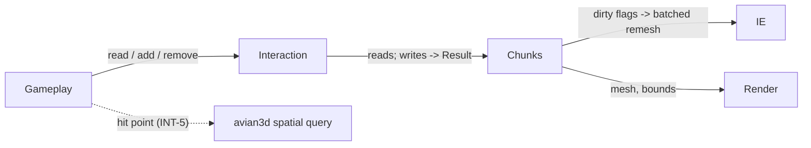

# Interaction

*Design. Nothing here is implemented yet. Written 2026-10-14. Every choice below
is an open decision unless it says "fact" and cites the code.*

## Summary

Interaction is the gameplay-facing way to **read and change voxel values**. A
gameplay system asks it "what is at this point?", "what is in this box?", or
"remove a sphere of radius 2 here". Interaction turns the request into sample
reads and writes, and hands them to **Chunks**, which owns the storage and is
the only writer of it. A write is applied at once and returns a `Result`, so a
refusal (chunk not loaded, outside the world) reaches the caller. Remeshing is
not immediate: the write marks chunks dirty and Chunks batches the remesh.
Interaction does not cast rays itself. How a gameplay hit point is found (a
physics raycast or a voxel walk) is decision INT-5.

---

## 1. What exists today (facts)

Nothing of this system exists. The pieces it would sit on:

| fact | where |
|---|---|
| The IE takes an `i8` buffer and an isolevel per job; solid is `> isolevel`. | `src/voxel_terrain/isosurface/mod.rs:133-138`, `:274-284` |
| `VoxelBuffer` has `get` / `set` by `(x, y, z)` and a flat `index`. | `src/voxel_terrain/isosurface/buffer.rs:62-74` |
| `Terrain` maps `(i32, i32, i32)` to `Grid<u8>` and has a point `get`. It is not wired in: `VoxelTerrainPlugin::build` is commented out. | `src/voxel_terrain/terrain.rs:9-39`, `src/voxel_terrain/mod.rs:17-21` |
| `pos_div_size` splits a global position into chunk and local coordinates. | `src/voxel_terrain/terrain.rs:41-59` |
| `VoxelMap` has an `i8` `get` / `set` by local position. Unused. | `src/voxel_terrain/voxel.rs:3-29` |
| `avian3d` is a dependency but no code uses it. | `Cargo.toml:7`, no `avian` in `src/` |
| `debug/picking.rs` is empty. | `src/voxel_terrain/debug/picking.rs` |

Two facts matter for the decisions below:

- **`pos_div_size` is wrong on negative multiples of the chunk size.**
  `minus_div` does `n / s - 1` for every negative `n`
  (`src/voxel_terrain/terrain.rs:42-45`). For `n = -8, s = 8` it returns chunk
  `-2` and local `8`, which is outside `0..8`. The test only checks `-9`
  (`:79-81`). `div_euclid` / `rem_euclid` give `-1` and `0`. Anything
  Interaction builds on must not reuse this function as it is.
- **The pinned `avian3d` is built for Bevy 0.17.** `Cargo.lock` resolves
  `avian3d 0.4.0` (git commit `60ef5cf`) against `bevy 0.17.2`, while the app
  uses `bevy 0.16.1`. Both Bevy versions are in the tree. avian's components and
  plugins are 0.17 types, so they cannot be added to this app's 0.16 `App`.
  Using avian at all (INT-5, INT-6) first needs a version that targets Bevy
  0.16 (the 0.3 line did, to be checked on crates.io) or a move to Bevy 0.17.

---

## 2. Role and boundary



- **Interaction owns:** the API, shape rasterisation (SDF to occupancy), the
  add / remove / paint rules, splitting a region over chunks, and the error
  type.
- **Chunks owns:** storage, the apron copies (if any), dirty flags, versions,
  and remesh scheduling. Interaction never writes storage directly. It calls a
  Chunks write function that can refuse.
- **Interaction does not own:** raycasts (unless INT-5 picks the voxel walk),
  colliders (section 7), meshes, or persistence of edits (a Chunks decision).
- **Water:** the fluid layer may add reads, writes and an error variant. The
  water design is in progress; see [`water-surface.md`](water-surface.md).

All message names here are **proposed**. None exist.

---

## 3. API shape

The API needs mutable access to Chunks' storage in the same system call, so
that a write can return a `Result`. That rules out anything deferred unless the
refusal comes back later as a message.

| option | how a call looks | Result at once? | trade-offs |
|---|---|---|---|
| **A. `SystemParam`** (`VoxelAccess<'w, 's>` wrapping `ResMut<Chunks>` or a query on chunk entities) | `voxels.remove(Sphere { .. })?` | yes | Simple. Every system using it conflicts with every other, so they run one at a time. Fine for a handful of gameplay systems. |
| **B. Methods on the Chunks resource** | `chunks.edit(...)` | yes | No extra type. Gameplay then sees all of Chunks' internals, which blurs the boundary. |
| **C. Edit queue resource + result message** | push `EditRequest`, read `EditResult` next frame | no, one frame later | Decouples timing and lets Chunks apply edits at a fixed point in its frame order. The caller has to match results to requests. |
| **D. `Commands` extension** | `commands.remove_voxels(...)` | no | Idiomatic, but commands run at a sync point with no return path. Refusals are lost or need C anyway. |

**Recommended: A**, because the brief asks for immediate application with a
`Result`, and A gives that without exposing Chunks' internals.

Proposed signatures (types are placeholders until CH and X settle the value
type and coordinates):

```rust
pub struct Voxel { pub occupancy: u8, pub material: u8 }

impl VoxelAccess<'_, '_> {
    pub fn get(&self, p: IVec3) -> Result<Voxel, EditError>;
    pub fn read_region(&self, min: IVec3, max: IVec3, out: &mut [Voxel]) -> Result<(), EditError>;
    pub fn apply(&mut self, edit: &Edit) -> Result<EditReport, EditError>;
}

pub enum Edit {
    Add    { shape: Shape, material: u8 },
    Remove { shape: Shape },
    Paint  { shape: Shape, material: u8 },
}
pub enum Shape { Sphere { centre: Vec3, radius: f32 }, Box { .. }, Capsule { .. } }
pub struct EditReport { pub samples_changed: u32, pub chunks_dirtied: u32 }
```

`p` is a global sample position. The global-to-chunk split uses
`div_euclid` / `rem_euclid` (or `>> 5` / `& 31` for 32-sample chunks), never
`/` and `%`; see section 1 for the bug in the existing helper.

---

## 4. Reads

- **Point:** `get(p)` returns the stored occupancy and material type at one
  sample. For a world position, the caller rounds to the nearest sample or the
  API offers `get_world(Vec3)`; which one is open.
- **Region:** `read_region(min, max, out)` fills a caller buffer, so a large
  read does not allocate. It walks the chunks the box overlaps and copies rows.
- **Trilinear sample (option):** `sample(Vec3) -> f32` blends the 8 samples
  around a point. Needed only by the voxel walk in INT-5.
- **Unloaded chunks:** a read of an unloaded or still-generating chunk returns
  `NotLoaded`. An alternative is to return the generator's value for unedited
  chunks, which needs the Generator to be callable synchronously (GEN
  decision).

Reads take `&self`, but with option A they still conflict with writers because
the param holds `ResMut`. A separate read-only param (`Res<Chunks>`) lets
read-only systems run in parallel.

---

## 5. Writes

### 5.1 Shapes to occupancy

A shape is a signed distance `d(p)` in voxels: negative inside, positive
outside. It is turned into a brush value with a linear ramp of width `w`
voxels, centred on the shape's surface:

```
brush(p) = round(MAX * clamp(0.5 - d(p) / w, 0, 1))      // 0..=MAX
add:     occ' = max(occ, brush)
remove:  occ' = min(occ, MAX - brush)
```

- Both rules are **idempotent**: applying the same edit twice changes nothing.
  So a held "dig" button can re-apply each frame without digging deeper, and a
  dropped or repeated edit message is harmless.
- `MAX` and the isolevel come from the value-type decision (X / CH). With the
  occupancy proposal (u8, e.g. `MAX = 15`, `ISO = 7`), the surface lands where
  `brush` crosses the isolevel, near `d = 0`.
- **Ramp width.** `w = 1` gives the sharpest shape, but central-difference
  normals then saturate and snap toward the axes (see [`rendering.md`](rendering.md)
  and the IE doc). A wider ramp gives smoother normals and rounder edges.
- **Blending limit.** `max` / `min` only blend inside the ramp, so a smooth
  union between an edit and the existing terrain cannot be wider than `w`.
  A wider blend needs a smooth-min formula, which loses idempotence.
- **Today's `i8` field.** If samples stay `i8`, the same rules hold with
  `MAX = 127`, empty `= -128` and the per-job isolevel. Only the constants
  change.
- **Coarse LODs.** If Chunks stores coarse LODs, an edit has to reach them
  (downsample after the edit, or rasterise at step `2^L`). That is a CH
  decision; Interaction only reports the touched region.

### 5.2 Type painting

The material type of a sample needs a rule, because `max` / `min` only act on
occupancy.

| option | rule | trade-offs |
|---|---|---|
| **P1. Set on turn-solid** | `Add` writes `material` where a sample goes from `<= ISO` to `> ISO` | Digging and refilling keeps old types elsewhere. Edits that only thicken already-solid samples leave the old type. |
| **P2. Set where the brush raised occupancy** | `Add` writes `material` wherever `occ' > occ` | Also recolours the ramp samples that border the new solid, which is what the mesh shows on its vertices (the vertex type is read near the surface). |
| **P3. Separate `Paint` only** | `Add` never changes type; `Paint` sets type where `brush > ISO` and the sample is solid | Clean split, but placing a new block of stone needs two calls. |

`Remove` leaves the type alone in all three; a removed sample becomes air and
its type is unused until something adds to it again. **Recommended: P2 plus a
separate `Paint`**, because the rendered material is taken from samples on the
surface ramp, and P1 leaves those with the old type.

### 5.3 Applying and refusing

An edit is applied immediately, in the calling system, and returns
`Result<EditReport, EditError>`.

```rust
pub enum EditError {
    NotLoaded { chunk: IVec3 },  // a touched chunk is not in memory (or still generating)
    OutOfBounds,                 // the edit leaves the world bounds (if CH sets any)
    // possible later: a fluid-related variant; water design in progress, see water-surface.md
}
```

| question | options |
|---|---|
| Which variants? | the two above; add `Busy` (chunk is generating; retry next frame) separate from `NotLoaded`; add `TooLarge` (edit touches more than K chunks) |
| An edit spans loaded and unloaded chunks | **all-or-nothing** (check every touched chunk first, then write); **partial** (write what is loaded, report the rest); **clip** to loaded chunks silently |
| An edit hits a chunk that is generating | refuse with `Busy`; queue it on the chunk and replay after generation (needs the edit stored, see CH persistence) |

**Recommended: all-or-nothing**, because partial edits leave visible half-craters
across a chunk border and make `Result` hard to act on.

### 5.4 Dirtying and batched remesh

A write never remeshes. Chunks records which chunks changed and remeshes them
in its scheduler, after all of the frame's edits.

- A changed sample can lie in up to 8 chunks' meshing input, depending on the
  apron decision (CH). With a 1-sample apron and 32-sample chunks, local
  samples 0 and 1 feed the `-` neighbour, 31 feeds the `+` neighbour, so a
  corner edit dirties the chunk and up to 7 neighbours.
- Several edits in one frame dirty each chunk once. The remesh then sees all of
  them.
- An edit lane with higher priority than streaming keeps digging responsive.
  The latency target (same frame, next frame, within N ms) is an open question.
- `EditReport` returns counts only. If gameplay needs to know when the new mesh
  is visible, Chunks can emit a proposed `ChunkRemeshed` message.

---

## 6. From a gameplay hit to a voxel (INT-5)

Gameplay usually starts with a ray (camera centre, a projectile). Two ways to
turn it into a voxel position:

| option | how | exactness | cost and dependencies |
|---|---|---|---|
| **R1. avian3d spatial query** | `SpatialQuery::cast_ray` against the terrain colliders; Interaction converts the hit point to a sample | Exact to the collider mesh, which is the LOD0 render mesh if built from the same `Surface` | Needs colliders (section 7) and an avian version on Bevy 0.16 (section 1). Hits on far chunks need colliders there too. Also gives shape casts and overlap tests for free. |
| **R2. Voxel DDA through the field** | Walk cells along the ray (Amanatides–Woo); in a cell with a sign change, find the root | Trilinear root finding differs from the MC triangles by up to about half a voxel. Exact only if the hit cell's triangles are rebuilt with the IE's `edge_t` / `place_at` and intersected | No physics. Works on any loaded chunk, colliders or not. Reads storage on the main thread. |
| **R3. Both** | R1 near the player, R2 for long range or when no collider exists | as above | Two code paths to test. |

With `interpolate: false` the mesh places vertices at edge midpoints
(`src/voxel_terrain/isosurface/mod.rs:305-308`), so a trilinear root is even
further from the rendered surface. R2 then needs the cell-triangle step to be
exact.

**Exactness is not always needed.** Picking which voxel to dig or which block
to highlight only needs the right cell. A projectile that must stop on the
visible surface does.

**Hit point to sample.** A hit lies on the surface, between a solid and an
empty sample. Options: step `ε` against the normal for `Remove` / `Paint`
(into the solid) and with it for `Add` (into the air), then round; or take the
nearest sample on the requested side of the hit cell. The rule must match the
sign convention (solid is `> isolevel`).

**Recommended: R1 if colliders exist anyway for player physics, R2 otherwise.**
The decision follows INT-6.

---

## 7. Physics colliders (a dependency, not owned here)

Interaction depends on colliders only through R1. Who builds them is open
(Chunks, Render, or a small physics bridge). The facts and options:

- avian has `Collider::trimesh(Vec<Vector>, Vec<[u32; 3]>)` and
  `Collider::trimesh_from_mesh(&Mesh)` (checked in the locked avian source,
  `src/collision/collider/parry/mod.rs:881`, `:1205`). The first can be fed
  from a `Surface` directly, before `into_mesh` moves its buffers.
- `trimesh_from_mesh` needs the mesh's CPU copy. Today `into_mesh` keeps one
  (`src/voxel_terrain/isosurface/mod.rs:244`); see RND-3 in
  [`rendering.md`](rendering.md).
- Flying edges output is welded, so a trimesh from it is about 6x smaller than
  from marching cubes output (README, Performance).
- Interpolated meshes can contain zero-area triangles where a sample equals
  the isolevel (README, Notes & gotchas). Whether parry accepts them must be
  tested.
- Rebuild cost after an edit is not measured. A per-frame budget for collider
  rebuilds, and colliders only within a radius of the player, are the options.

---

## 8. Chunk borders and world bounds

- **Borders.** An edit's bounding box is split per chunk with `div_euclid`.
  Each chunk gets its own clipped write. With padded (apron) storage, Chunks
  also writes the copies in neighbours; with unpadded storage it gathers at
  meshing time. Either way it is Chunks' job, but the edit's result must be the
  same as one write into a single large buffer (test T3).
- **World bounds.** Whether the world has limits is a CH decision (one
  proposal: a vertical limit such as ±256, air above, bedrock below). If it
  does, an edit that leaves them returns `OutOfBounds`, or is clipped. If
  bedrock exists, `Remove` must not touch it; that is a "protected sample"
  rule, open.
- **Unloaded neighbours.** An edit near the edge of the loaded area can touch
  an unloaded chunk only through its apron. Under all-or-nothing that refuses
  the edit, which can feel arbitrary to the player. Loading data one ring
  beyond the mesh radius (a CH option) avoids it.

---

## 9. Testing

Pure functions first, so most tests need no `App`:

| test | checks |
|---|---|
| T1 brush idempotence | `apply(e); apply(e)` equals `apply(e)` for add, remove, paint |
| T2 add/remove | `remove(s)` after `add(s)` on empty space gives empty space; on full space `add` changes nothing |
| T3 border equivalence | an edit across 8 chunks gives the same samples as the same edit on one large buffer, including negative coordinates and exact multiples of the chunk size |
| T4 refusal | an edit touching an unloaded chunk changes no sample anywhere and returns `NotLoaded` |
| T5 dirty set | an edit at local sample 0, 1, 31 and a corner dirties exactly the expected chunks |
| T6 remesh | after an edit and the batched remesh, the chunk mesh equals a fresh full extraction of the same data |
| T7 hit to sample | for rays against `test_maps` fields, the chosen sample is solid for remove and empty for add |
| T8 DDA vs mesh (if R2) | DDA hits lie within the stated tolerance of a brute-force ray–triangle test on the extracted `Surface` |

---

## Decisions

| ID | question | options | recommended | affects |
|---|---|---|---|---|
| INT-1 | API shape | SystemParam; methods on Chunks; edit queue + result message; Commands | SystemParam: immediate `Result` without exposing Chunks | gameplay code, system ordering |
| INT-2 | Error variants | NotLoaded, OutOfBounds; + Busy; + TooLarge; + a fluid variant later | NotLoaded + OutOfBounds now, others when a caller needs them | gameplay error handling |
| INT-3 | Edits across loaded and unloaded chunks | all-or-nothing; partial; clip | all-or-nothing: no half-applied craters | CH load radius, UX near the loaded edge |
| INT-4 | Type painting | P1 turn-solid; P2 raised occupancy; P3 paint only | P2 + separate Paint: matches what the mesh samples | RND material ID, generator types |
| INT-5 | Hit point source | avian spatial query; voxel DDA; both | follows INT-6 | physics dependency, accuracy |
| INT-6 | Terrain colliders | from LOD0 surfaces in a radius; everywhere loaded; none | open: depends on whether player physics needs avian | avian version, memory, CPU per edit |
| INT-7 | Ramp width of brushes | 1 voxel; 2+ voxels; per brush | open: tied to the normal-quality decision | look, normals, blend width |
| INT-8 | Edits on generating chunks | refuse with Busy; queue and replay | open | CH lifecycle, persistence |
| INT-9 | Read of unloaded data | NotLoaded; ask the Generator | NotLoaded: keeps the Generator off the main thread | GEN API |

## Open questions

- Which gameplay features need edits at all (digging, building, explosions),
  and how large is the biggest edit? This sets `TooLarge` and the edit-lane
  budget.
- What remesh latency is acceptable after an edit: same frame, next frame?
- Is avian needed for player movement? If so, the Bevy 0.16 / 0.17 mismatch has
  to be solved first, and colliders exist anyway.
- Should edits be undoable? An operation log (a CH persistence option) would
  make undo cheap.
- Are some samples protected (bedrock, world border)?
- Do multiplayer or replays matter? Idempotent edits and an operation log fit
  them; nothing here assumes them.
- Does `pos_div_size` get fixed or replaced? Either way, a test for exact
  negative multiples is needed.
