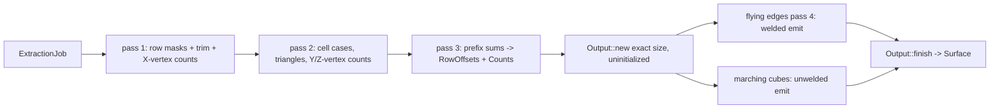

# Isosurface extractor (IE)

*As built on 2026-10-14, from `src/voxel_terrain/isosurface/`. Everything under
[Planned changes](#planned-changes) is an open decision; nothing there is implemented.*

## Summary

The IE turns a cubic buffer of `u8` samples into a triangle mesh (`Surface`). It is a pure
service: one function call, buffer in, `Surface` out, plus a thin Bevy wrapper (a queue resource,
a results resource, one system in `ExtractSet`). It knows nothing about chunks, LOD, materials or
`Assets<Mesh>`. Two emitters share one counting scan: **flying edges** (welded, gradient normals)
and **marching cubes** (unwelded, face normals). They produce the same triangles and differ only in
vertex sharing and normals. The README explains the algorithms in depth
([How it works](../README.md#how-it-works)); this document is the contributor's map: API,
data flow, invariants, files, tests, and the open decisions for changing the IE.
For where the IE sits among the other systems, see [architecture.md](architecture.md).

---

## 1. Role and boundary

| | |
|---|---|
| Input | `ExtractionJob { buffer: VoxelBuffer, method: Method, interpolate: bool }`; samples are `u8` on `0..=S_MAX` (15), solid when `> ISO` (7), both constants in `mod.rs` |
| Output | `ExtractionResult { id, method, interpolate, surface }` (`mod.rs:177`); `Surface` = positions, normals, `u32` indices (`mod.rs:217`) |
| State | `ExtractionScratch`, the scan buffers only (`scratch.rs:36`) |
| Touches | `IsosurfaceQueue`, `IsosurfaceResults`, `ExtractionScratch` resources. Never `Assets<Mesh>`, entities or other systems. |
| Size limit | `MAX_SIZE = 64` samples per axis (`mod.rs:88`), asserted in `RowScan::new` (`scan.rs:159`) |
| Threading | Single-threaded, on the main schedule (`mod.rs:441`) |

Today the only caller is the demo, `IsosurfaceDebugPlugin` (`debug.rs:21`), which queues
`test_maps::solid_cube(4)` through both methods (`debug.rs:16`, `debug.rs:33`). Chunks is not wired
in: `VoxelTerrainPlugin::build` is commented out (`voxel_terrain/mod.rs:18`). Converting a `Surface`
into a mesh entity is Render's job ([rendering.md](rendering.md)); `Surface::into_mesh` is a
convenience only. Water is not part of the IE; its design is in progress in
[water-surface.md](water-surface.md).

## 2. Public API

All paths are relative to `src/voxel_terrain/isosurface/`.

```rust
pub const MAX_SIZE: usize = 64;                                           // mod.rs:88
pub enum Method { #[default] FlyingEdges, MarchingCubes }                 // mod.rs:97
pub type Interpolate = bool;          // false = edge midpoint            // mod.rs:129
pub const S_MAX: u8 = 15;                                                 // mod.rs
pub const ISO: u8 = 7;                                                    // mod.rs
pub struct ExtractionJob { pub buffer: VoxelBuffer,
                           pub method: Method, pub interpolate: Interpolate } // mod.rs
pub struct JobId(pub u64);                                                // mod.rs:143
pub struct ExtractionResult { pub id: JobId, pub method: Method,
                              pub interpolate: Interpolate, pub surface: Surface } // mod.rs:177
pub struct Surface { pub positions: Vec<Vec3>, pub normals: Vec<Vec3>,
                     pub indices: Vec<u32> }                              // mod.rs:217
impl Surface { fn is_empty, triangle_count, vertex_count, into_mesh(self) -> Mesh } // mod.rs:223-249

pub fn extract_with(scratch: &mut ExtractionScratch, job: &ExtractionJob) -> Surface; // mod.rs:254
pub fn extract(job: &ExtractionJob) -> Surface;      // throwaway scratch // mod.rs:270

#[derive(Resource)] pub struct IsosurfaceQueue;      // push -> JobId, len, is_empty, take  mod.rs:147
#[derive(Resource)] pub struct IsosurfaceResults;    // drain, len, is_empty            mod.rs:186
#[derive(SystemSet)] pub struct ExtractSet;                                // mod.rs:404
pub fn drain_extraction_queue(queue, results, scratch);  // system        // mod.rs:407
pub struct IsosurfacePlugin;  // inits the 3 resources, adds the system to Update in ExtractSet  mod.rs:432

pub struct VoxelBuffer;  // new, from_samples, size, cells_per_axis, samples(_mut),
                         // index, get, set, row, cell_corners      buffer.rs:13-98
pub struct ExtractionScratch;  // new, with_capacity, reserve, capacity_bytes  scratch.rs:36-79
```

The per-method entry points are public too: `flying_edges::extract_into` / `extract`
(`flying_edges.rs:101`, `:137`) and `marching_cubes::extract_into` / `extract`
(`marching_cubes.rs:52`, `:90`). The scan types (`RowScan`, `RowMetadata`, `RowOffsets`, `Counts`)
are `pub` in `scan.rs` but are internal plumbing. `tables` and `test_maps` are `pub` modules;
`test_maps` is used by the bench.

Behaviour worth knowing:

- `drain_extraction_queue` runs every job queued so far, in queue order, in one frame
  (`mod.rs:416`). There is no per-frame budget. A consumer ordered `.after(ExtractSet)` sees the
  results in the same frame (`debug.rs:28`).
- Results carry `JobId`, `method` and `interpolate` back. Nothing else is echoed.
- `into_mesh` moves the buffers into a `TriangleList` mesh with `MAIN_WORLD | RENDER_WORLD`
  (`mod.rs:244`), so a CPU copy stays alive. It does not recompute normals.
- A buffer with `size < 2` returns an empty `Surface` (`flying_edges.rs:109`,
  `marching_cubes.rs:60`). A buffer over 64 panics (`scan.rs:159`), and that check runs first.

## 3. Data flow



**Scan (`scan.rs`).** See [Counting first](../README.md#counting-first-scanrs).

- *Pass 1* (`scan.rs:241`). Per sample row `(y, z)`, bit `x` of a `u64` is set when sample `x` is
  `<= isolevel` (`scan.rs:252`). `mask ^ (mask >> 1)` gives cut X edges, whose popcount is the row's
  X-vertex count (`scan.rs:256`). `mask | (mask >> 1)` gives the edges with at least one empty corner;
  its first and last bit are the trim (`scan.rs:265`). An empty range is `left > right`
  (`scan.rs:271`). The trim skips solid runs only, not air (README, *Project status*).
- *Pass 2* (`scan.rs:300`). For each cell row, the case is assembled from four row masks
  (`cell_case`, `scan.rs:399`), triangles come from `TRIANGLE_COUNT`, and with `VERTICES = true` the
  Y/Z vertices come from `EDGE_INTERSECTION`. A row counts its near Y/Z edges; at the volume
  boundary it also counts the far ones, and adds some to *other* rows (`scan.rs:336-348`). Marching
  cubes uses `count_triangles` (`scan.rs:198`), which skips the vertex half (`scan.rs:320`).
- *Pass 3* (`scan.rs:361`). Prefix-sum into `RowOffsets` (X, then Y, then Z vertices per row; index
  start) and the exact `Counts`.

**Flying edges, pass 4** (`flying_edges.rs:216`). See
[Smooth surfaces](../README.md#smooth-surfaces-flying_edgesrs). Per cell row, 12 vertex IDs are
seeded from the offsets (`:245`) and stepped along X by the cut bits (`:269-272`, `:327-335`). Each
cell writes positions and normals only for `cut & owned` (`:285`), then writes the indices of all its
triangles through `ORDER` (`:312-321`).

**Marching cubes** (`marching_cubes.rs:100`). See [Hard faces](../README.md#hard-faces-marching_cubesrs).
One cursor per cell row, starting at `RowOffsets::indices` (`:120`). Uniform cells are skipped from
the case alone (`:128`). Each triangle gets three new vertices, one face normal and identity
indices (`:141-165`).

## 4. Invariants

| Invariant | Where | What breaks it |
|---|---|---|
| **Sign:** solid `> isolevel`, empty `<= isolevel`. A case bit is set for an **empty** corner. | `mod.rs:3-12`, `case_index` `mod.rs:276`, `scan.rs:252` | The table winds normals toward set corners, so the reverse sense gives an inside-out mesh that back-face culling hides. Pinned by `winding_faces_away_from_the_solid`. |
| **Corner index:** `i` = x bit 0, y bit 1, z bit 2. | `VERTEX_POSITIONS` `tables.rs:41`, `cell_corners` `buffer.rs:86` | `cell_corners_follow_the_table_convention` |
| **Edge numbering:** trust `EDGE_VERTEX_INDICES` (`tables.rs:52`). Edges 1, 3, 5, 7 are vertical (Y); 8-11 run along Z. | `tables.rs:52-65` | The corner diagram (left half, `tables.rs:26-34`) is right. The **edge** diagram beside it (right half) is stale: it labels the verticals 4-7 and swaps 10/11. Tables in Bourke's layout need remapping. |
| **Slot order:** `ORDER` (`tables.rs:87`) maps a table edge to a vertex-ID slot; `SLOT_EDGE` (`flying_edges.rs:168`) is its inverse. Slots 0-3 are X edges per bounding row, 4-7 Y, 8-11 Z. | `bounding_rows` `scan.rs:94` vs `cell_case` `scan.rs:399` | The two read rows in different orders, on purpose (`scan.rs:91-93`). |
| **Ownership:** a cell writes slots 0/4/8 (table edges 0/3/8), plus far slots only when the owning neighbour is outside the volume. | `owned_slots` `flying_edges.rs:178` | Each arm mirrors a counter in pass 2 (`scan.rs:331-348`). Change both together. Pinned by `ownership_partitions_the_vertices_exactly`. |
| **Write-once output:** buffers are allocated uninitialized at the counted size; every slot is written exactly once; `Output::finish` is the one `unsafe` (`set_len`). | `output.rs:51`, `output.rs:87-104` | Debug builds pre-fill NaN / `u32::MAX` (`output.rs:60-66`) and `finish` panics if any survives (`output.rs:88-96`). |
| **Size:** at most 64 samples per axis. | `mod.rs:88`, `scan.rs:159`, `low_bits` `scan.rs:140` | A row mask is one `u64`. |
| **`edge_t` direction:** `t` runs from the edge's *first* corner in `EDGE_VERTEX_INDICES`. Edges 2, 3, 6, 7 run toward lower coordinates. | `mod.rs:305-327` | The same physical edge reached as a different table edge can land one ULP away. Inside one flying-edges mesh each edge is computed once, so this is invisible; across chunks it is not (see Open questions). |
| **Normals:** finite and unit. FE: negated, `t`-blended central-difference gradient, one-sided on buffer faces, falling back to the edge direction (solid to empty) where it cancels. MC: face normal, same fallback for zero-area triangles. | `gradient_normal` `mod.rs:337`, `sample_gradient` `mod.rs:360`, `edge_fallback` `mod.rs:384`, `marching_cubes.rs:151` | The one-sided faces are the chunk-seam normal bug (IE-2). |
| **Same triangles:** both methods and both `interpolate` settings match a longhand reference triangle for triangle. | `tests.rs:144` | |

## 5. Memory and allocation

- **Scratch** (`scratch.rs:36`): `corner_masks: Vec<u64>`, `rows: Vec<RowMetadata>`,
  `offsets: Vec<RowOffsets>`, each `size²` entries. Reset with `clear` + `resize`
  (`scratch.rs:80-91`), never shrunk. On a 64-bit target that is 8 + 48 + 48 = 104 B per row:
  about 104 KiB at 32³, 124 KiB at 35³, 416 KiB at 64³.
- **Output** (`output.rs`): new `Vec`s per extraction at exactly the counted size, moved into the
  `Surface` and on into the `Mesh` with no copy. FE: 24 B per vertex + 4 B per index. MC: 28 B per
  index (one vertex per index). On dense noise at 32³ MC writes about 282k vertices against FE's
  45k (README, *Performance*).
- The pool stops growing after warm-up, but every extraction still allocates its output. The
  allocator is mimalloc (`main.rs`, bench `:18`); the README explains why that matters.
- `extract` and the per-method `extract` build a throwaway scratch (`mod.rs:270`).

## 6. Files

| File | Responsibility |
|---|---|
| `mod.rs` | Public types, the queue/results/plugin, `extract(_with)`, vertex placement (`case_index`, `place_vertex`, `edge_t`, `place_at`) and normals (`gradient_normal`, `sample_gradient`, `edge_fallback`, `face_normal`). |
| `buffer.rs` | `VoxelBuffer`: X-major `Vec<u8>` cube, `row` slice, `cell_corners` in table order. |
| `scan.rs` | Passes 1-3 (`RowScan`), row metadata/offsets, `cell_case`, trim helpers. |
| `flying_edges.rs` | Pass 4: welded emission, `owned_slots`, `SLOT_EDGE`. |
| `marching_cubes.rs` | Unwelded emission with face normals. |
| `output.rs` | Uninitialized exact-size output, debug sentinel, `finish` (the `unsafe`). |
| `scratch.rs` | `ExtractionScratch` pool. |
| `tables.rs` | `VERTEX_POSITIONS`, `EDGE_VERTEX_INDICES`, `TRIANGLE_COUNT`, `ORDER`, `EDGE_INTERSECTION`, `TRIANGLE_TABLE`, `EDGE_AXIS_ORIGIN` (tested, unused). |
| `test_maps.rs` | Fields for tests, demo and bench; returns a `VoxelBuffer`, samples relative to `ISO`. |
| `debug.rs` | Demo scene: both methods side by side, sample gizmos. |
| `tests.rs` | Cross-validation and the cross-cutting tests below. |

## 7. Tests

42 tests in `voxel_terrain::isosurface`, all passing on 2026-10-14 (`cargo test --lib voxel_terrain::isosurface`).

| Group | Tests | Guards |
|---|---|---|
| Cross-validation | `solid_cube_4/8`, `single_voxel`, `scattered_voxels`, `terrain`, `flat_slab`, `sphere`, `pseudo_random`, `a_chunk_at_the_size_limit` (`tests.rs:163-210`) | Every (method, interpolate) equals `reference` (`tests.rs:40`) after 1/1024 quantisation; `triangles_of` also requires every vertex slot to be referenced (`tests.rs:86-102`). |
| Scan | `pass_1_packs_a_row_into_its_bits`, `a_fully_solid_row_is_trimmed_away`, `both_scans_agree_on_the_triangle_count`, `a_chunk_over_the_size_limit_is_rejected` (`scan.rs:422-507`) | Mask bits, empty-trim encoding, `count` vs `count_triangles`, size assert. |
| Ownership / exact output | `the_scan_sizes_the_output_exactly`, `ownership_partitions_the_vertices_exactly`, `emission_leaves_no_slot_unwritten` (debug only) (`flying_edges.rs:349-449`) | Counts = written sizes; `owned_slots` = pass 2; no sentinel survives. |
| Welding | `flying_edges_welds_exactly_the_shared_vertices`, `both_methods_agree_on_the_triangle_count`, `passes_run_over_the_terrain_field` (`tests.rs:637-703`); `every_triangle_gets_its_own_vertices`, `empty_rows_emit_nothing` (`marching_cubes.rs:179-207`) | FE vertex count = distinct MC positions; MC indices are the identity. |
| Winding and normals | `winding_faces_away_from_the_solid`, `normals_are_unit_and_finite`, `vertex_normals_point_away_from_the_solid`, `gradient_normals_agree_with_their_faces`, `a_slab_has_exactly_vertical_normals`, `a_cancelled_gradient_falls_back_to_the_edge`, `marching_cubes_normals_are_face_normals` (`tests.rs:330-549`) | Sign convention, unit/finite normals, one-sided faces, the tie fallback. |
| Placement | `place_at_lands_where_the_longhand_formula_does`, `interpolation_moves_vertices_but_not_topology` (`tests.rs:308`, `:554`) | The `edge_t` + `place_at` split is bit-exact; interpolation changes positions only. |
| Tables | `triangle_count_matches_the_triangle_table`, `edge_intersection_marks_exactly_the_cut_edges`, `edge_axis_origin_agrees_with_the_vertex_indices` (`tests.rs:584-633`) | Derived tables agree with `TRIANGLE_TABLE` / `EDGE_VERTEX_INDICES`. |
| Pool and inputs | `a_reused_pool_matches_a_fresh_one`, `a_warm_pool_stops_growing`, `empty_field_yields_an_empty_surface`, `a_buffer_too_small_to_hold_a_cell_is_handled` (`tests.rs:217-305`); `resetting_keeps_capacity`, `reserve_does_not_change_length` (`scratch.rs:106-133`); 3 `buffer.rs` tests | Stale rows across sizes, no regrowth, degenerate sizes. |

## 8. Benchmark

`cargo run --release --example isosurface_bench` (`examples/isosurface_bench.rs`). Five fields
(`main`, `:132`): sphere 64³ and 32³, noise 32³, slab 32³, cube 16³; `interpolate: true`. Each
method runs "cold" (new scratch per run) and "pooled", with one uncounted warm-up, 400/100/25 runs
by size (`:27`), and times `into_mesh` separately (`:73-77`). Release only, because the dev
profile builds the crate at `opt-level = 1`. Results are in the README
([Performance](../README.md#performance)). Mean pooled ms on one i5-13500H core: FE 2.67 / MC 1.73
on the 64³ sphere, FE 1.68 / MC 2.25 on dense noise. Use these numbers to compare the cost of the
planned changes below.

---

## Planned changes

Each item is an open decision. "Code that would change" lists the places a change touches today.
**Must still pass** means the existing tests that pin current behaviour, run with the defaults.

### IE-1. Sample type, isolevel and interpolation target

> **B done 2026-10-19**, with a twist: `S_MAX = 15` and `ISO = 7` are
> constants, so the job no longer carries an isolevel at all. Test maps were
> shifted onto the new scale; output is bit-identical to the `i8` version.
> **D done the same day.** `CROSSING = ISO + 0.5` in `mod.rs`; the sphere's
> nudge and the tie field are gone, and `vertices_sit_strictly_inside_their_edges`
> checks it.

*Question:* keep `i8` density, or switch to `u8` occupancy (0 = empty … max = full) with a
configurable isolevel; and should vertices interpolate to `iso + 0.5`?

| Option | Trade-offs |
|---|---|
| A. Keep `i8` | No work. Doesn't match the proposed storage. `Terrain` is already `Grid<u8>` (`terrain.rs:11`). |
| B. `u8`, isolevel per job | Mostly a type change. The max value is **not** an IE input: classification needs only the isolevel. Tests port by +128, which preserves order and differences, so positions and gradients stay bit-identical. `tables.rs` is unaffected (its `i8` is table data with a `-1` sentinel). |
| C. Generic sample trait (`i8` and `u8`) | Keeps both. Monomorphises the scan and emitters twice. More code for no current caller. |
| D. Interpolate to `iso + 0.5` (any type) | For integer samples, `s > iso` is the same as `s > iso + 0.5`, so the topology is unchanged. `t = (iso + 0.5 − from)/(to − from)` is strictly inside (0, 1), so no vertex lands on a grid point and the tie case (`gradient_tie`, the nudge at `test_maps.rs:117-119`) goes away. Positions move, so it is no longer bit-compatible with today. |

B and D are independent. *Recommended:* B + D, because D removes the t = 0 degeneracy for free once
samples are integers on a small scale.

*Code that would change:* `buffer.rs:14`, `:31`, `:66`, `:70`, `:76`, `:86`; `mod.rs:135`, `:276`,
`:293-294`, `:305-314` (and the `+ 0.5` for D), `:337-352`, `:384`; `scan.rs:151`, `:158`, `:172`,
`:252`; `flying_edges.rs:104`, `:137`; `marching_cubes.rs:55`, `:90`; every field in
`test_maps.rs`; `tests.rs:40`, `:144`, `:379`, `:392`, `:400-408`, `:570`; bench `:89`;
`debug.rs:16`.

*Tests to add:* a ported-field equivalence test (an `i8` field + 128 gives identical triangles,
under B alone); with D, every vertex is strictly inside its edge and there are no zero-area
triangles on `pseudo_random`. `a_cancelled_gradient_falls_back_to_the_edge` needs a new field
whose gradients cancel without a tie, because `edge_fallback` stays reachable.
*Must still pass:* all cross-validation (the reference calls `place_vertex`, so it follows D
automatically; `place_at_lands_where_the_longhand_formula_does` is the independent check and must
be updated for D), the scan, ownership, winding and normal tests.

### IE-2. Interior margin for the apron

*Question:* how does the IE mesh only the inner cells of a buffer padded with a 1-sample apron, so
neighbouring chunks compute the same central-difference normals at shared vertices?
The seam bug is in `sample_gradient` (`mod.rs:369-376`): one-sided differences on buffer faces,
so two chunks compute different normals for the same border vertex.

With N cells per chunk the padded input is N + 3 samples per axis (local −1 … N + 1). 32 cells → 35
samples; 61 cells is the most that fits `MAX_SIZE`.

| Option | Trade-offs |
|---|---|
| A. `margin: usize` on the job (0 = today) | Existing callers and tests unchanged. Touches the scan and both emitters. |
| B. A separate padded-buffer type or entry point | Same internals as A, with the margin in the type. Two API surfaces. |
| C. Mesh the whole padded buffer and drop apron triangles | No scan change, but breaks exact sizing and wastes the apron cells' work. |
| D. No apron: pass neighbour gradients in separately | Keeps N + 1 samples. A new input format, and Chunks still has to gather neighbour data. |

*Recommended:* A, so the default of 0 keeps every current test meaningful.

*Code that would change:* pass 1 (`scan.rs:243-288`): mask the cut/touched bits to inner edges and
zero `x_vertices` on apron rows. Pass 2 (`scan.rs:302-306`, `:331-348`): loop ranges and
`last_row`/`last_cell` move in by the margin. FE emit (`flying_edges.rs:227-239`, `:262`, `:288`):
ranges, `last_cell`, trim clamp, and positions shifted by −margin (gradients keep buffer
coordinates). MC emit (`marching_cubes.rs:111-133`): the same. `extract_with` (`mod.rs:254`) passes
the margin through. Pass 3 is unchanged.

*Tests to add:* cross-validation with margin 1 against the reference restricted to inner cells and
shifted; `ownership_partitions_the_vertices_exactly` and `emission_leaves_no_slot_unwritten` with
margin 1; a seam test that cuts one field into two padded chunks and requires identical normals at
shared border vertices (and positions, see Open questions).
*Must still pass:* everything, at margin 0. `a_slab_has_exactly_vertical_normals` keeps covering the
one-sided path, which margin 1 no longer reaches for inner vertices.

### IE-3. Per-vertex material ID

*Question:* should `Surface` carry a material per vertex, and how is it chosen?

| Option | Trade-offs |
|---|---|
| A. Type of the cut edge's solid corner | A cut edge has exactly one solid corner, so the value is well defined and the same from every cell. Works for welded FE vertices and for MC. One read per vertex. |
| B. Per cell (dominant type) | Natural for MC; undefined for a welded vertex shared by up to four cells. |
| C. Several IDs + weights per vertex | Allows blending; more data per vertex and a more complex shader. |
| D. None: shade by slope/height in the shader | No IE change. See [rendering.md](rendering.md). |

*Recommended:* A, because it is the only rule that is consistent for welded vertices.

Render cost: Bevy 0.16 has no single-`u8` vertex format (`Uint8x2/x4`, `Uint32` exist); a custom
attribute needs an `ExtendedMaterial` with vertex and prepass shaders and `@interpolate(flat)`.
The debug sentinel in `output.rs:60-66` relies on NaN; an integer channel needs a reserved
value or has to rely on the position check alone.

*Code that would change:* `ExtractionJob` gains a type buffer (`mod.rs:133`), padded like the
density (IE-2); `Surface` (`mod.rs:217`) and `into_mesh` (`mod.rs:241`); `Output` and `Slots`
(`output.rs:32-46`, `:51-128`); FE writes at `flying_edges.rs:298-306`; MC at
`marching_cubes.rs:155-160`.
*Tests to add:* every vertex's ID equals its edge's solid-corner type; FE and MC agree at equal
positions; sentinel coverage for the new buffer. *Must still pass:* all, with geometry unchanged.

### IE-4. Uniform test and face-connectivity bits from the scan

*Question:* should the IE report "uniform" (all inner samples on one side of the iso) and/or
open-air face connectivity, given it already has the row masks?

For uniform: over the inner (N + 1)³ samples, every row mask must be all zeros (all solid) or
every mask must be all ones in its inner bits (all empty). "AND of masks == OR of masks" is wrong:
it passes striped chunks. On a connected grid, "uniform" is equivalent to "zero triangles", which
the scan already reports, so the gain is skipping pass 2 and emission, not new information.
"Uniform for meshing" is weaker than "uniform storage" (identical bytes); keep them apart
([chunks.md](chunks.md)).

| Option | Trade-offs |
|---|---|
| A. Nothing in the IE; Chunks checks storage before queueing | No IE change; catches only byte-identical chunks. |
| B. Early-out after pass 1, flag on the result | Cheap (one pass over `size²` words). Still needs a queued job per chunk. |
| C. Connectivity bits (15 per chunk, Checchi) in the IE from the masks | Masks are already built, but the bits arrive only after meshing. Culling wants them right after generation, and uniform chunks may never be meshed. |
| D. Connectivity in Chunks after generation, reusing pass 1 as a helper | Available early; needs pass 1 exposed outside `RowScan`. |

*Recommended:* B for uniform, D for connectivity (reason: culling needs it before meshing).

*Code that would change:* `RowScan::scan` (`scan.rs:202-221`) returns early; `Counts`
(`scan.rs:74`) or `ExtractionResult` (`mod.rs:177`) gains a flag; callers at
`flying_edges.rs:113`, `marching_cubes.rs:67`. For D, `pass_1` (`scan.rs:241`) becomes reusable.
*Tests to add:* all-solid and all-empty detected; a striped field is not uniform; on every test map,
uniform ⇔ zero triangles; with IE-2, an apron that differs from the interior doesn't break the
flag. *Must still pass:* scan tests, `empty_field_yields_an_empty_surface`, cross-validation.

### IE-5. Job metadata: chunk, version, LOD, type

*Question:* what does `ExtractionJob` carry beyond the samples?

| Option | Trade-offs |
|---|---|
| A. Keep `JobId`; the caller maps `JobId → (chunk, version, LOD)` | Works today; the IE stays chunk-agnostic. The caller keeps a map. |
| B. Opaque `tag: u64` (or generic `T`) echoed on the result | Small change, still chunk-agnostic. |
| C. Typed `chunk`, `version`, `lod` fields | Self-describing, but couples the IE to Chunks' types. |

Separate echo data from real inputs. LOD is an input only if the IE scales positions by 2^L (Render
could do that with a `Transform` instead) or builds transition faces (IE-7). Type is an input
(IE-3). *Recommended:* A or B, so the IE stays a pure service.

*Code that would change:* `mod.rs:133-138`, `:177-182`, `:418-423`; every `ExtractionJob` literal
(`debug.rs:37`, `tests.rs:152`, `:233`, `:256`, `:281`, `:296`, `:311`, `:342`, `:418`, `:448`, bench
`:101`). `ExtractionJob` has no `Default` (`VoxelBuffer` has none), so a constructor would avoid
touching every literal again. *Tests to add:* the tag round-trips through the queue.
*Must still pass:* all.

### IE-6. Running on the async task pool

*Question:* where does extraction run, and how is scratch shared?

| Option | Trade-offs |
|---|---|
| A. Keep synchronous, add a per-frame job cap | Simple; frame time grows with work (about 0.4 ms per 32³ sphere chunk). |
| B. One task per job on `AsyncComputeTaskPool`, `thread_local!` scratch | No locking; scratch lives per worker thread. The pool defaults to 25% of cores (min 1, max 4), shared with generation. |
| C. One task per job, scratch checked out of a pool and returned with the result | Explicit ownership; a small lock or channel. |
| D. Split one extraction across threads by Z blocks | Emission is ready for it, but pass 2's cross-row writes (`scan.rs:337`, `:344`) block it, and one chunk per worker parallelises better. |

`extract_with` is already pure and `ExtractionJob` owns its buffer, so the task body exists today.
Results would arrive out of order and across frames; consumers must match on `JobId`. Dropping a
`Task` cancels it only before it starts. Whether the IE or Chunks owns the tasks (a task component
on the chunk entity gives cancellation on despawn) is a [chunks.md](chunks.md) decision.
*Recommended:* B, because it keeps the pool's "no allocation after warm-up" property per thread.

*Code that would change:* `drain_extraction_queue` (`mod.rs:407-425`), `IsosurfacePlugin`
(`mod.rs:434-443`), the `Resource` derive on `ExtractionScratch` (`scratch.rs:35`).
*Tests to add:* an `App` test that queues N jobs, updates until done and gets every `JobId` back
once; thread-local scratch gives results equal to `extract`.
*Must still pass:* `a_reused_pool_matches_a_fresh_one`, `a_warm_pool_stops_growing`, cross-validation.

### IE-7. Transvoxel transition pass and secondary positions

*Question:* if Render chooses Transvoxel for LOD seams ([rendering.md](rendering.md)), what does the
IE add? Skirts instead would be a smaller IE change (extra triangles on chunk faces) or none
(generated by Render).

IE side of Transvoxel: Lengyel's transition tables (512 cases, 56 classes); a 2D transition pass
per flagged face; shrunk boundary cells with a secondary position and a 6-bit mask per vertex; fine
samples on the coarse chunk's transition faces as an extra input. A transition row has 2N + 1 = 65+
samples for N = 32, so it does not fit a `u64` mask (use `u128`, two words, or a plain loop).
[transvoxel-face-ambiguity.md](transvoxel-face-ambiguity.md) shows our regular table matches
Lengyel's if the transition case index uses our bit meaning and his winding is reversed; the
transition cells' own faces are unverified. Building all 6 transition meshes per chunk and toggling
them (godot_voxel's approach) means a neighbour's LOD change needs no remesh.

*Code that would change:* a new `transition.rs` and tables; `Surface` (`mod.rs:217`) and `Output`
gain secondary positions and masks; FE emit computes them at the vertex write
(`flying_edges.rs:298`); the job gains transition-face flags and fine face samples.
*Tests to add:* the transition-table ambiguity check from the face-ambiguity doc; seam
watertightness (fine chunk + coarse chunk with transition mesh, no open edge); secondary positions
stay inside their cell. *Must still pass:* all, with no transition faces flagged.

### IE-8. Normals for occupancy

*Question:* with a ~1-voxel occupancy ramp, central differences saturate and normals snap toward
the axes. What does the IE do?

| Option | Trade-offs |
|---|---|
| A. Accept it | No change; fits a choppy look. |
| B. Wider ramp in the data | No IE change; Generator and Interaction write it ([generator.md](generator.md)). |
| C. 3×3×3 stencil | Smoother. Apron 2 → N + 5 samples (32 cells → 37; 59 cells max). About 27 reads per corner instead of 6, on top of today's 17-20 ns per vertex. |
| D. Area-weighted face normals on the welded mesh | Independent of the ramp. A post-pass over indices; consistent across chunks only if apron cells are meshed and discarded. |

*Code that would change:* `sample_gradient` (`mod.rs:360-379`) for C; a new pass after FE emit for D;
the normals doc on `Surface` (`mod.rs:213-215`). *Tests to add:* on an occupancy sphere, the angle
between each normal and the radial direction stays under a bound; the seam test from IE-2.
*Must still pass:* `normals_are_unit_and_finite`, `vertex_normals_point_away_from_the_solid`,
`gradient_normals_agree_with_their_faces`; `a_slab_has_exactly_vertical_normals` (slab normals stay
vertical under C and D).

---

## Decisions

| ID | Question | Options | Recommended | Affects |
|---|---|---|---|---|
| IE-1 | Sample type and interpolation target | i8 / u8 / generic; iso vs iso + 0.5 | u8 + iso + 0.5 | Chunks storage, Generator, Interaction, all IE tests |
| IE-2 | Meshing a padded buffer | margin param / padded type / mesh-and-drop / neighbour gradients | margin param, default 0 | Chunks gather, chunk size (≤ 61 cells), seams |
| IE-3 | Per-vertex material | solid-corner type / per cell / weights / none | solid-corner type | Render vertex layout and shaders, Chunks type layer |
| IE-4 | Uniform and connectivity flags | none / early-out flag / IE connectivity / Chunks connectivity | early-out + connectivity in Chunks | Chunks scheduler, Render culling |
| IE-5 | Job metadata | JobId map / opaque tag / typed fields | JobId map or tag | Chunks lifecycle, versioning |
| IE-6 | Where extraction runs | sync + cap / task + thread-local / task + pool / intra-chunk | task + thread-local | Chunks scheduler, frame order |
| IE-7 | LOD seams, IE side | none / skirts / Transvoxel | — (follows RND) | Render, Chunks (fine face samples), IE output format |
| IE-8 | Occupancy normals | accept / wider ramp / 3×3×3 / face normals | — | Apron width (IE-2), Generator ramp, look |

## Open questions

- **Bitwise border positions.** `edge_t` interpolates from the edge's first corner. A Y edge on an
  X face is edge 1 (from below) for the −X chunk and edge 3 (from above) for the +X chunk; an X edge
  on a Y face is edge 2 vs edge 0. A float32 check over all `i8` corner pairs (iso 0, 2, 7)
  found that about 11.5% of crossings land one ULP apart. Z faces and Z edges agree. Should the IE
  place every vertex from the edge's lower corner, so that neighbouring chunks' border vertices are
  bit-identical?
- Should LOD scaling of positions happen in the IE or in a `Transform`?
- Does terrain need `Method::MarchingCubes` and `interpolate: false` once the look is chosen, or are
  they kept for comparison and tests only?
- Should `MAX_SIZE` grow (`u128` rows) if chunk size or Transvoxel faces need it?
- Is the `Surface` CPU copy kept by `into_mesh` (`mod.rs:244`) wanted (colliders, picking) or
  should Render drop it?
- Source comments that have drifted: the `owned_slots` doc (`flying_edges.rs:141-162`) is attached to
  `SLOT_EDGE`, so `owned_slots` has no rustdoc; both `extract_into` docs say the result is "copied
  out" (`flying_edges.rs:96`, `marching_cubes.rs:47`), but it is moved; `EDGE_AXIS_ORIGIN`'s doc says
  marching cubes uses it to weld (`tables.rs:387-389`), which it no longer does;
  `a_warm_pool_stops_growing` says extraction "must stop calling the allocator altogether"
  (`tests.rs:248-249`), but the output is still allocated every run. Fix them when IE code next
  changes?
